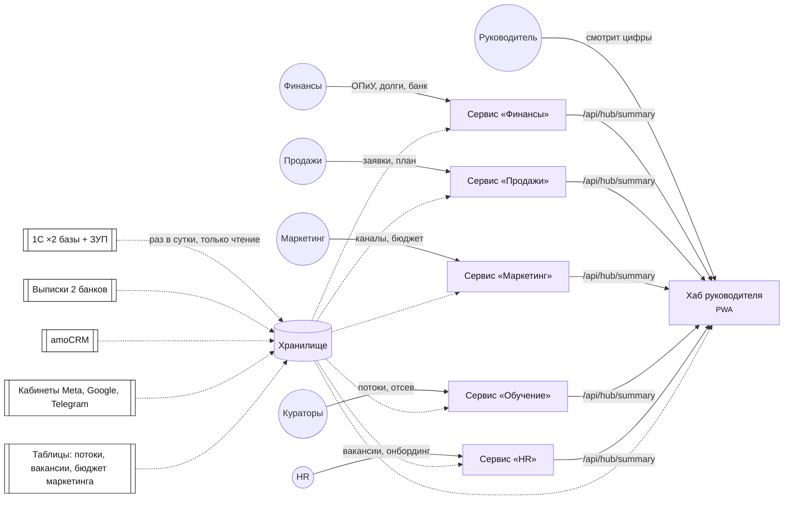
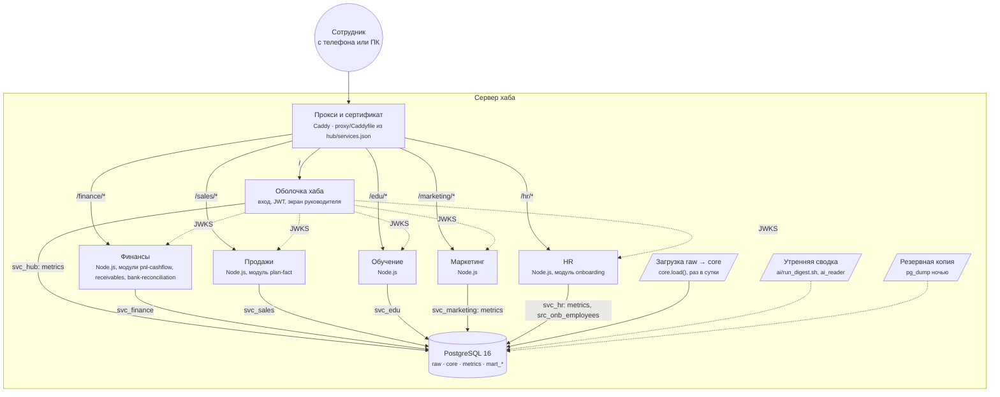
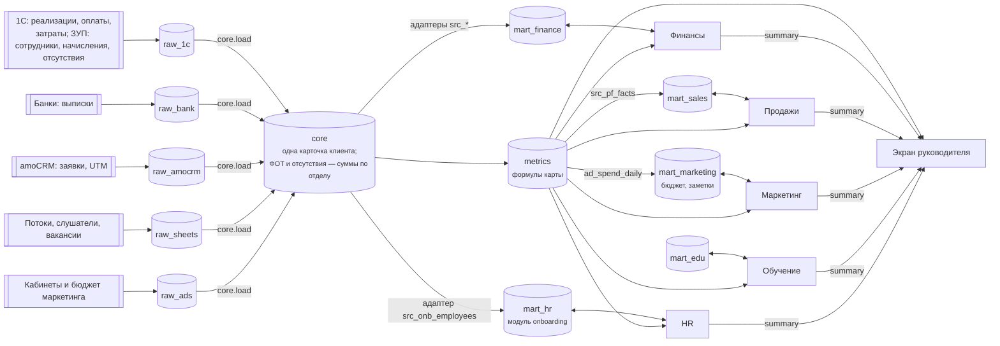
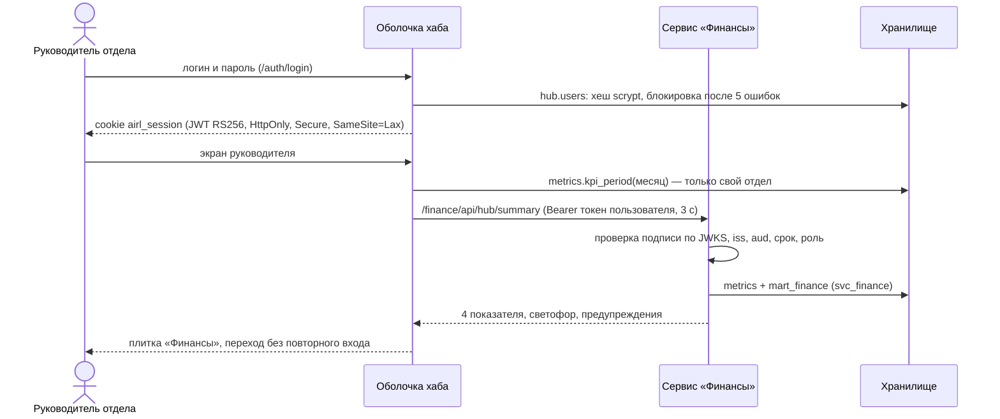
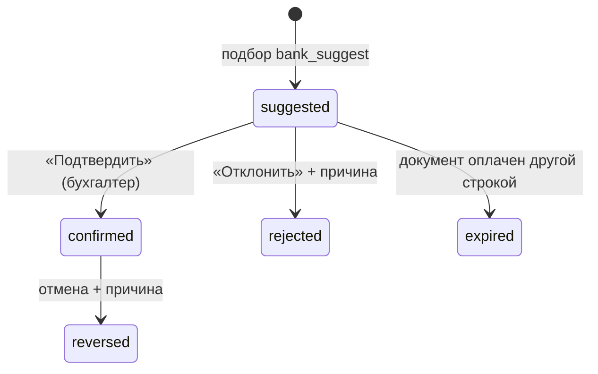

# Архитектура демо-хаба AIRL

Хаб — оболочка (вход, шапка, экран руководителя, реестр) и пять сервисов отделов на одном домене
по путям `/finance`, `/sales`, `/marketing`, `/edu`, `/hr`. Все читают одно хранилище PostgreSQL: общие данные `core`,
единые показатели `metrics`; каждый пишет только в свою витрину `mart_<отдел>`.

## Страна и закон
Казахстан, KZT, НДС 12 % (показатели без НДС). Закон РК о персональных данных: база и копии —
на территории РК (в бою — сервер в РК; в демо — локальная песочница). Особых данных нет.

```yaml
# airl-context
mode: hub
country: KZ
currency: KZT
languages: [ru]
data_kind: personal          # имена и ИИН слушателей-физлиц, ФИО сотрудников (синтетические); окладов в хабе нет
login: hub                   # демо-издатель JWT RS256 в оболочке; в бою — Authentik
data_organization: shared-db-schemas
needs_dwh: true
dwh: postgresql-16 (raw_* → core → metrics → mart_<отдел>), 5 витрин
nosql: false
orchestrator: false          # загрузка — функция core.load() раз в сутки (cron на сервере)
level: 2
services: ["hub: оболочка и экран руководителя", "finance: ОПиУ, должники, сверка банка", "sales: воронка и план-факт", "marketing: каналы, кампании, бюджет рекламы", "edu: потоки и отсев", "hr: кадры, вакансии, онбординг, ФОТ по отделам"]
maintainer: team             # сервер, прокси и копии ведёт команда AIRL
unknowns: ["сервер и домен хаба", "доступ к 1С AIRL (OData)", "поддержка после курса"]
```

## 1. Контекст


Как читать: фиолетовое построено в демо; белое — системы AIRL (в демо их заменяют синтетические
выгрузки той же формы). Пунктир — только чтение: в 1С, банк и amoCRM хаб ничего не пишет.

## 2. Структура продукта


Как читать: прокси не срезает путь — каждый сервис собран под свой `base_path`. Каждый сервис
ходит в базу своим пользователем; права проверены атаками (`SECURITY.md`).

## 3. Поток данных


Как читать: модули читают данные только через адаптеры `src_*`; показатели модулей сверены
с `metrics` до копейки (`tests/reconcile.sql`, 0 расхождений). Оплата труда для ОПиУ — одна лента
`metrics.expense_entries` (ЗУП по дням месяца) и для хаба, и для модуля pnl-cashflow. Расход на рекламу
и ФОТ закрытых месяцев сверены с проводками 1С («Реклама», «ФОТ»).

## 4. Вход и открытие сервиса (главный сценарий)



## 5. Статусы (сопоставление строки банка — модуль bank-reconciliation)



## Решения
| Вопрос | Решение | Почему |
|---|---|---|
| Стек сервисов | Node.js 22 без фреймворков, `pg`, PWA на чистом JS | одна зависимость; любой участник курса прочитает код |
| Вход | встроенный издатель JWT в оболочке (RS256 + JWKS) | демо без сервера; контракт тот же, что у Authentik, замена без правки сервисов |
| Хранилище | одна база, схемы по слоям, пользователь на сервис | права «свой участок» держит база, а не код |
| Прокси | Caddy, конфиг генерируется из реестра | `/airl-hub` часть 5, `/airl-devops` |
| ИИ | шаблонная сводка `/airl-ai` без модели | ключа API нет; числа те же, что в `metrics` |
| HR и маркетинг | свои сервисы; HR — модуль onboarding, маркетинг — без модуля leads (воронка в amoCRM) | `/airl-modules`, карта, раздел 10 |
| ПДн сотрудников | ФИО — отдельная таблица только для адаптера HR; оклады в хаб не попадают, ФОТ — по отделам (меньше 3 человек — объединены) | закон РК о ПДн, минимум данных |
| Цена в месяц (бой, оценка) | VPS в РК 4 vCPU/8 ГБ ≈ 25–35 тыс. ₸ + копии в другом ДЦ РК ≈ 5 тыс. ₸ | для ~35 сотрудников и 6 процессов Node.js хватает с запасом |
