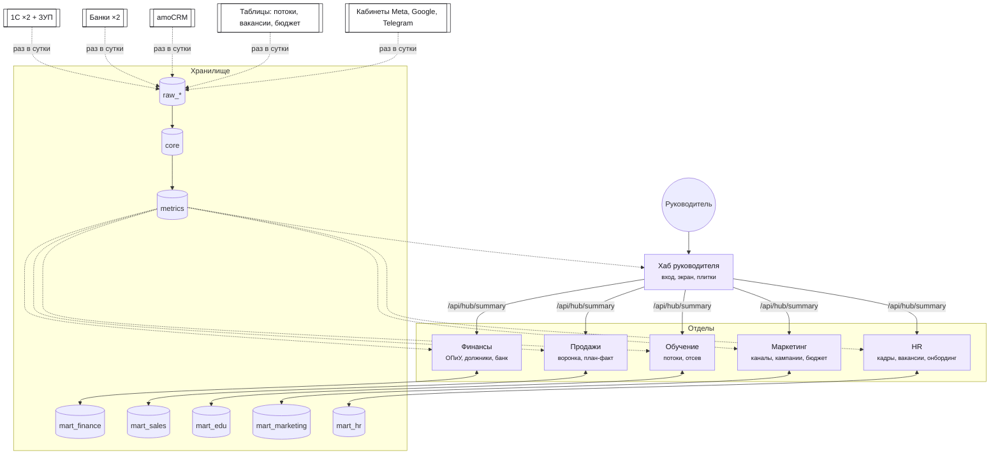

# Карта компании AIRL (AI Research Labs) — ДЕМО

> Демо-карта. Составлена по `/airl-spec` (режим A) без интервью с людьми: ответы, которые
> навык спросил бы у руководителя и финансового директора, приняты по рекомендации навыка
> и перечислены в разделе 10 «Решено по умолчанию». Все данные хаба — синтетические, похожие
> на выгрузки 1С:Бухгалтерии для Казахстана, банков и amoCRM. Настоящей 1С AIRL не касались.

## 1. О компании
AIRL — обучение и консалтинг по ИИ: курс VibeOps (потоки слушателей), корпоративное обучение,
разработка и внедрение ИИ-решений, консалтинг. Казахстан, Алматы. ~25 сотрудников
(в синтетике: 38 записей кадров за историю, 33 работают — с отделами HR и маркетинга). Валюта отчётов — **KZT**. Деньги смотрим **без НДС** (НДС 12 %).

| Страна и закон | Значение |
|---|---|
| Страна данных | KZ |
| Закон о персональных данных | Закон РК «О персональных данных и их защите» — проверить у юриста |
| Где хранить данные и копии | на территории РК (база и резервные копии) |
| Особые данные | нет |
| Телефон, идентификаторы | +7 XXX XXX XX XX; БИН — юрлица, ИИН — физлица (ПДн) |
| Языки интерфейса | для сотрудников: ru · для клиентов: не применяется (клиенты в хаб не входят) |

### 1a. Юрлица, филиалы, города
| id | Юрлицо / филиал | Город | База 1С | Продаёт другим подразделениям |
|---|---|---|---|---|
| `airl` | ТОО «AI Research Labs» | Алматы | своя (infobase `airl`) | нет |
| `airl_dev` | ТОО «AIRL Dev» | Алматы | своя (infobase `airl_dev`) | да: субподряд «учебные ИИ-ассистенты» для `airl` — внутригрупповые продажи исключаются |

## 2. Системы и источники правды
| Система | Что в ней | Главная для | Ответственный | Доступ к данным | Как забираем (заполняет airl-dwh) |
|---|---|---|---|---|---|
| 1С:Бухгалтерия для Казахстана (2 базы) | реализации, оплаты (р/с, касса), затраты, сотрудники | деньги, выручка, расходы, клиенты-плательщики | главный бухгалтер | в демо — CSV той же формы | `data/generate_1c.py` → `raw_1c` (в бою: OData, окно 45 дней) |
| Выписки банков «Демо Банк Алатау», «Демо Банк Степь» | строки выписок | движение по счёту до разнесения в 1С | бухгалтер | в демо — CSV | `raw_bank.statement_lines` (в бою: 1CClientBankExchange) |
| amoCRM | заявки, воронка, UTM-метки (источник, кампания) | заявки, конверсия, кампания заявки | руководитель продаж | в демо — CSV | `raw_amocrm` (в бою: API, `/airl-connect`) |
| 1С:Зарплата и управление персоналом (ЗУП) | сотрудники, начисления (оклад + налоги работодателя), отпуска и больничные | численность, ФОТ, отсутствия | руководитель HR | в демо — CSV той же формы | `raw_1c.zup_*` (в бою: OData ЗУП); в `core` — только суммы по отделу и месяцу |
| Таблица вакансий HR (Google Таблица) | вакансии: открыта, закрыта, источник, отклики | вакансии и срок найма | руководитель HR | в демо — CSV | `raw_sheets.vacancies` |
| Рекламные кабинеты Meta Ads, Google Ads, Telegram Ads | расход по дням и кампаниям (utm_campaign), показы, клики | расход на рекламу | руководитель маркетинга | в демо — CSV | `raw_ads.ad_spend`, `raw_ads.ad_campaigns` (в бою: API кабинетов, `/airl-connect`) |
| Таблица бюджета маркетинга | мероприятия, реферальные выплаты, бюджет каналов по месяцам | расход вне кабинетов, бюджет при подключении | руководитель маркетинга | в демо — CSV | `raw_ads.ad_spend` (каналы event, referral), `raw_ads.mkt_budget` |
| Google Таблица потоков | потоки курса, слушатели, посещаемость | потоки и обучение | руководитель обучения | в демо — CSV | `raw_sheets` |
| сервис `finance` (mart_finance) | действия по долгам, сопоставления банка, бюджет | бюджет, сверка | финансовый директор | хаб | читается из витрины |
| сервис `sales` (mart_sales) | планы продаж | планы | руководитель продаж | хаб | читается из витрины |
| сервис `edu` (mart_edu) | отметки «риск отсева» | риск отсева | руководитель обучения | хаб | читается из витрины |
| сервис `hr` (mart_hr) | онбординг: чек-листы, пункты, ознакомления (модуль onboarding) | онбординг | руководитель HR | хаб | читается из витрины |
| сервис `marketing` (mart_marketing) | бюджет каналов по месяцам, заметки к кампаниям | бюджет рекламы | руководитель маркетинга | хаб | читается из витрины |

Правило: если системы расходятся, верна та, что указана в «Главная для». Деньги — 1С; заявки — amoCRM;
ФОТ — ЗУП (за закрытый месяц совпадает с проводкой 1С «ФОТ» — проверка `tests/reconcile.sql`); расход на рекламу —
кабинеты и таблица бюджета (за закрытый месяц совпадает с 1С «Реклама» без НДС — та же проверка).

## 3. Одна карточка клиента
Сущность: **клиент** (компания или слушатель). Ключи склейки по порядку: 1) БИН компании / ИИН
физлица из карточки контрагента 1С; 2) телефон в формате +7 **вместе с** именем (слушатели из
amoCRM); 3) e-mail в нижнем регистре. `client_id` в хранилище — хеш, без ПДн.
Свои юрлица — не клиенты. Конфликты — разбирает главный бухгалтер.

## 4. Единые показатели

### revenue — Выручка
- Формула: сумма документов «Реализация товаров и услуг» без НДС
- Источник: 1С (обе базы): проведённые, без пометки удаления
- Дата: дата документа реализации (оказания услуги), а не дата оплаты — решено по умолчанию: B2B с отсрочкой
- НДС / валюта: без НДС / KZT
- Исключаем: внутригрупповые продажи (`airl_dev` → `airl`), отменённые документы
- Зерно: день × клиент × направление (курс, корпоративное обучение, разработка, консалтинг)
- Владелец: финансовый директор · Обновление: раз в сутки, «сегодня» = вчера
- Детализация: `metrics.revenue_daily`

### gross_margin — Валовая маржа
- Формула: (выручка − прямые расходы) / выручка × 100; прямые расходы — статьи затрат 1С «Подрядчики» и «Облако и API ИИ», без НДС
- Источник: 1С · Дата: дата документа · Исключаем: внутригрупповые обороты
- Семейство: `gross_margin:all` (компания), `gross_margin:airl`, `gross_margin:airl_dev`
- Светофор: ≥ 65 % — ok; 55–65 % — warning; ≤ 55 % — danger · Владелец: финансовый директор

### net_profit — Чистая прибыль
- Формула: выручка − все расходы (включая оплату труда, аренду, рекламу, налог на прибыль), без НДС, без внутригрупповых
- Оплата труда — как `payroll_fund`: начисление ЗУП месяца равномерно по дням. В 1С зарплата проводится одной
  суммой в последний день месяца, и без этого «с 1-го по вчера» шло бы без ФОТ (прибыль завышена в разы, сравнение
  «те же дни прошлого месяца» бессмысленно). За закрытый месяц сумма та же, что в 1С. Налог на прибыль — по 1С, в конце месяца
- Семейство: `net_profit:all` · Текущий месяц — предварительно (плановое начисление ЗУП, налог ещё не начислен)
- Светофор: > 0 — ok; ≤ 0 — danger · Владелец: финансовый директор

### cash_balance — Остаток денег
- Формула: начальные остатки + поступления (р/с и касса) − списания по 1С на конец дня
- Источник: 1С · Валюта: KZT · Строки выписки, ещё не разнесённые в 1С, не входят
- Светофор: ≥ 25 млн — ok; 12–25 млн — warning; < 12 млн — danger

### receivables_overdue — Просроченная дебиторка
- Формула: сумма остатков (с НДС) по реализациям, у которых срок оплаты прошёл на конец дня; переплаты не вычитаются
- Источник: 1С (реализации и оплаты по документу-основанию) · Исключаем: внутригрупповые
- Светофор (меньше — лучше): < 8 млн — ok; 8–15 млн — warning; ≥ 15 млн — danger
- Детализация: `metrics.receivables_aging()`

### receivables_overdue_share — Доля просрочки в дебиторке
- Формула: просроченная дебиторка / весь открытый долг × 100. Источник: сервис `finance` (модуль receivables)

### lead — Заявки
- Формула: число заявок amoCRM по дате создания (Asia/Almaty); **повтор того же телефона в течение 30 дней — та же заявка**
- Источник: amoCRM · Владелец: руководитель продаж · Светофор: к прошлому периоду ≥ −10 % ok, ≥ −25 % warning

### conversion_lead_to_deal — Конверсия заявки в оплату
- Формула: заявки, закрытые «Успешно реализовано» в периоде / заявки, созданные в периоде × 100 (без дублей)
- Ловушка: это «конверсия периода», а не когорта заявок; так она не «проседает» в текущем месяце
- Светофор: ≥ 8 % ok; 5–8 % warning; ≤ 5 % danger

### avg_check — Средний чек
- Формула: выручка (как `revenue`) / число разных клиентов с реализацией в периоде
- Светофор: к прошлому периоду ≥ −10 % ok, ≥ −25 % warning

### plan_completion — Выполнение плана
- Формула: факт за месяц / активный план месяца × 100 (модуль plan-fact); разрезы `plan_completion:revenue`, `:lead`, `:enrollments`
- Источник: сервис `sales` (mart_sales); факт — из `metrics`. Светофор по прогнозу: ≥ 95 % ok, 85–95 % warning

### enrollments — Записи на курс
- Формула: число мест курса VibeOps в документах реализации по дате документа (корпоративные места — по количеству)
- Источник: 1С · Владелец: руководитель обучения

### cohort_fill_rate — Заполненность потоков
- Формула: проданные места / вместимость по потокам, которые стартуют в течение 45 дней после конца периода
- Источник: 1С (места) + таблица потоков (вместимость) · Детализация: `metrics.cohort_fill_rate_detail`
- Светофор: ≥ 85 % ok; 70–85 % warning; ≤ 70 % danger

### course_completion_rate — Доля завершивших курс
- Формула: завершили / (завершили + отчислены) по потокам, закончившимся за 90 дней до конца периода
- Источник: таблица потоков · Светофор: ≥ 80 % ok; 65–80 % warning

### edu_at_risk — Слушатели под риском отсева
- Формула: число активных отметок куратора «риск отсева». Источник: сервис `edu` (mart_edu)

### bank_unmatched_count — Неразнесённые строки выписки
- Формула: строки выписки без сопоставления старше 2 дней. Источник: сервис `finance` (модуль bank-reconciliation)

### bank_auto_match_rate — Доля строк, разнесённых по подсказке
- Формула модуля bank-reconciliation. Источник: сервис `finance`

### headcount — Численность
- Формула: сотрудники с датой приёма ≤ даты и без увольнения на дату (на конец периода). Источник: 1С:ЗУП (без ФИО и окладов)
- Владелец: руководитель HR · Отдел на экране руководителя: HR

### turnover_rate — Текучесть за 12 месяцев
- Формула: уволенные за 12 месяцев до конца периода / средняя численность (на начало и конец этих 12 месяцев) × 100
- Скользящее окно, чтобы день и неделя не давали «0 % или 400 %». Источник: 1С:ЗУП · Меньше — лучше
- Светофор: < 12 % ok; 12–20 % warning; ≥ 20 % danger · Владелец: руководитель HR

### time_to_hire — Срок закрытия вакансии
- Формула: среднее число дней от открытия вакансии до найма по вакансиям, закрытым наймом за 180 дней до конца периода
- Отменённые вакансии не входят. Источник: таблица вакансий HR · Единица: дни · Меньше — лучше
- Светофор: < 35 дн. ok; 35–50 warning; ≥ 50 danger

### open_vacancies — Открытые вакансии
- Формула: вакансии, открытые на конец периода (открыта ≤ даты, не закрыта и не отменена к дате)
- Источник: таблица вакансий HR · Светофор: < 3 ok; 3–5 warning; ≥ 6 danger

### payroll_fund — Фонд оплаты труда
- Формула: начислено по ЗУП (оклады, премии) + налоги и взносы работодателя, без НДС; начисление месяца — равномерно по дням
- Текущий месяц — плановое начисление ЗУП (предварительно). Исключаем: ничего (внутригрупповых нет)
- Персональные данные: в хаб — только суммы по отделам; отделы, где меньше 3 человек, объединяются
  («Малые отделы»), чтобы по сумме нельзя было узнать оклад. Оклады людей в `core` не загружаются
- Светофор: рост к тем же дням прошлого периода < 10 % ok; 10–25 % warning; ≥ 25 % danger · Владелец: руководитель HR
- Детализация: `metrics.payroll_by_department(с, по)`, `metrics.m_payroll_fund`

### onboarding_on_time_rate — Онбординг в срок
- Формула модуля onboarding: пункты чек-листа адаптации, выполненные не позже срока / все пункты со сроком в прошлом
  или уже выполненные (без пропущенных), по месяцу срока. Источник: сервис `hr` (mart_hr)
- Светофор: ≥ 85 % ok; 70–85 % warning; < 70 % danger

### ad_spend — Расход на рекламу
- Формула: расход рекламных кабинетов (Meta, Google, Telegram) + мероприятия и реферальные выплаты из таблицы бюджета,
  без НДС, KZT, по дню расхода. За закрытый месяц = проводки 1С «Реклама» (сверка)
- Меньше — лучше: светофор по росту к тем же дням прошлого периода < 20 % ok; 20–40 % warning; ≥ 40 % danger
- Владелец: руководитель маркетинга · Детализация: `metrics.marketing_channels`, `metrics.marketing_campaigns`

### cpl — Цена заявки (CPL)
- Формула: `ad_spend` / `lead` (заявки периода без дублей, все каналы). По каналу и кампании — расход канала / заявки канала (utm_source, utm_campaign)
- Меньше — лучше: рост < 10 % ok; 10–25 % warning; ≥ 25 % danger

### cac — Цена слушателя (CAC)
- Формула: `ad_spend` / заявки воронки «Курс VibeOps», оплаченные в периоде (как в `conversion_lead_to_deal`, без дублей)
- B2B-сделки ведут менеджеры, их в CAC нет. Меньше — лучше: рост < 10 % ok; 10–25 % warning; ≥ 25 % danger

### romi — Окупаемость рекламы (ROMI)
- Формула: (выручка оплаченных в периоде заявок воронки «Курс VibeOps» без НДС − `ad_spend`) / `ad_spend` × 100
- Ловушка: по выручке, а не по марже — окупаемость завышена на долю прямых расходов; последние 1–2 месяца «дозревают»
- Светофор: > 200 % ok; 100–200 % warning; ≤ 100 % danger · Источник формулы — модуль `leads` (раздел 10)

### marketing_conversion — Конверсия заявок на курс
- Формула: заявки воронки «Курс VibeOps», закрытые оплатой в периоде / заявки этой воронки, созданные в периоде × 100 (без дублей)
- Светофор: > 8 % ok; 5–8 % warning; ≤ 5 % danger

### mkt_budget_usage — Исполнение рекламного бюджета
- Формула: прогноз расхода месяца (факт / прошедшие дни × дни месяца) / бюджет месяца по всем каналам × 100
- Источник: сервис `marketing` (mart_marketing, бюджет), факт — `metrics.ad_spend_daily` · Меньше — лучше: < 110 % ok; 110–125 % warning; ≥ 125 % danger

## 5. Хранилище (структуру детализирует /airl-dwh — см. DWH.md)
| Слой | Схема | Кто читает | Кто пишет |
|---|---|---|---|
| Сырой | `raw_1c` (в т. ч. ЗУП), `raw_bank`, `raw_amocrm`, `raw_sheets`, `raw_ads` | загрузка | `airl_loader` |
| Общие данные | `core` | сервисы — по списку `data.reads` | только загрузка `core.load()` |
| Показатели | `metrics` | все сервисы, хаб, ИИ-слой | только команда AIRL (`metrics_owner`) |
| Витрина отдела | `mart_<отдел>` | сервис отдела, ИИ-слой (только `m_<…>`) | только сервис отдела (`svc_<отдел>`) |
| Хаб | `hub` | оболочка хаба | `svc_hub` |

## 6. Отделы и сервисы
| id | Отдел | Руководитель | Главная боль | Сервис | Даёт доступ | Статус |
|---|---|---|---|---|---|---|
| `finance` | Финансы | финансовый директор | ОПиУ собирается вручную раз в месяц, дебиторка и неразнесённые платежи не видны | ОПиУ, должники, сверка банка | — | в хабе (демо) |
| `sales` | Продажи | руководитель продаж | заявки amoCRM не сходятся с оплатами 1С, план не виден до конца месяца | Воронка и план-факт | — | в хабе (демо) |
| `marketing` | Маркетинг | руководитель маркетинга | расход кабинетов не сведён с заявками amoCRM и оплатами 1С: цена заявки и окупаемость каналов не видны, бюджет перерасходуется незаметно | Каналы, кампании, бюджет | — | в хабе (демо) |
| `edu` | Обучение | руководитель обучения | заполненность потоков и отсев видны слишком поздно | Потоки и слушатели | — | в хабе (демо) |
| `hr` | HR | руководитель HR | вакансии висят месяцами, онбординг ведётся в чатах, ФОТ и текучесть руководитель узнаёт из бухгалтерии раз в квартал | Кадры, вакансии, онбординг, ФОТ по отделам | — | в хабе (демо) |

## 7. Роли и доступы
| Роль | Кто | Видит | Может менять |
|---|---|---|---|
| `ceo` | руководитель | все отделы, все показатели; имена физлиц — с маской | ничего в витринах |
| `head_finance` / `head_sales` / `head_marketing` / `head_edu` / `head_hr` | руководители отделов | экран руководителя только своего отдела, свой сервис целиком | витрину своего отдела |
| `staff_finance` | бухгалтер | сервис «Финансы» (имена должников без маски) | действия по долгам, сопоставления банка |
| `staff_sales` | менеджер | только свои открытые заявки | напоминания по своим заявкам |
| `staff_edu` | куратор | только свои потоки, имена слушателей | отметки «риск отсева» |
| `staff_marketing` | маркетолог (SMM) | сервис «Маркетинг» целиком (без контактов); заметки — только к кампаниям своих каналов | заметки к кампаниям своих каналов |
| `staff_hr` | HR-менеджер | онбординг своих отделов (имена — «Имя Ф.»), вакансии; **без ФОТ** | пункты онбординга своих отделов |

Персональные данные: имена и ИИН слушателей, телефоны, e-mail, ФИО сотрудников · хранятся: РК (в бою — сервер в РК) ·
без маски видят: бухгалтерия (`*_finance`), обучение (`*_edu`), HR (`*_hr` — сотрудников, в виде «Фамилия И.»).
ФИО сотрудников — отдельная таблица `core.employee_names`, читает только адаптер HR; оклады в `core` не загружаются
вовсе (ФОТ — только суммой по отделу и месяцу); больничные — только днями по отделу. ФОТ видят `ceo` и `head_hr`.

## 8. Правила подключения к хабу
1. Цифры только из `metrics` или по определениям раздела 4. Свои формулы для показателей из карты запрещены.
2. Сервис читает `core` (по списку) и `metrics`, пишет только в `mart_<свой отдел>` — правами базы.
3. Вход только через хаб. Роль и отдел — из проверенного токена на сервере.
4. Ключи не в коде и не в репозитории; один источник — `.env` на сервере (права 600).
5. В папке сервиса лежат `SPEC.md` и `airl.service.json`.
6. Сервис отдаёт `GET /<id>/healthz` и `GET /<id>/api/hub/summary`.
7. PWA в дизайне хаба (раздел 9).
8. Новая версия — после `REVIEW.md` без блокирующих; откат одной командой.
9. Запись в 1С, amoCRM и банк — только после курса (интеграционный сервис). Исключений нет.
10. Модель ИИ получает только агрегаты из `metrics` и `m_<…>`; ключ на сервере.

### Контракт входа (заполнено командой AIRL — демо)
| Что | Значение |
|---|---|
| Провайдер входа | **демо:** встроенный издатель JWT в оболочке хаба (`/auth/login`); в бою — Authentik на `auth.<домен хаба>` |
| Издатель токена (`iss`) | `https://hub.airl.kz` (переменная `AIRL_ISSUER`) |
| Аудитория (`aud`) | `airl-hub` |
| Публичные ключи (JWKS) | `/.well-known/jwks.json` оболочки хаба (RS256) |
| Поля токена | `sub`, `email`, `role`, `department` (+ `name`) |
| Как токен приходит в сервис | cookie `airl_session` (HttpOnly, Secure, SameSite=Lax, Path=/) **или** `Authorization: Bearer` |
| Нет токена или просрочен | API → 401 без перенаправления; страница → `/login?next=` |
| Открыто без токена | `/<id>/healthz`, статика оболочек; вебхуков нет |
| Тестовые пользователи | `ceo`, `head_*`, `staff_*` для finance, sales, marketing, edu, hr; пароль — `DEMO_PASSWORD` при первом запуске, в карту не пишется |

### Среда для разработки (заполнено командой AIRL — демо)
| Что | Как получить |
|---|---|
| Тестовое хранилище со схемами `core`, `metrics`, `mart_<отдел>` | `bash scripts/setup_db.sh` — роль `svc_<отдел>` с паролем в `.env` (генерируется, в git не попадает) |
| Сервер хаба | не развёрнут (нет доступа к серверу airl.kz) — локально `scripts/dev_up.sh` или `docker compose up` |
| Шаблон репозитория сервиса | `services/<id>/` этого демо |

Тестовое хранилище — полностью синтетическое (обезличивать нечего).

## 9. Дизайн хаба
| Токен | Значение |
|---|---|
| `--airl-color-primary` | #8f7bf0 (для текста — #5b45c9) |
| `--airl-color-bg` | #e8e8f2 |
| `--airl-color-text` | #16161a (и тёмная шапка-«таблетка») |
| `--airl-color-success` / `warning` / `danger` | #1d7f57 / #a35f00 / #c2334d |
| `--airl-font` | Inter Tight (цифры — Victor Mono), Google Fonts, OFL |
| `--airl-radius` | 26px (поля и кнопки), карточки 22px |
Логотип: `services/shared/static/logo-airl-white.png` (с airl.kz) · Домен хаба: в демо `127.0.0.1:8080`, в бою — НЕИЗВЕСТНО

Как читать: фиолетовое построено в демо, белое — системы компании (здесь — синтетические выгрузки).
Пунктир — только чтение. Каждый сервис пишет только в свою витрину.

## 10. Решено по умолчанию
- Режим A0 (`SCOPE.md`) пропущен по брифу; отделы выбраны: финансы, продажи, обучение; в версии 1.1 добавлены HR и маркетинг.
- Выручка — по дате реализации (не оплаты), без НДС; внутригрупповые продажи `airl_dev` → `airl` исключены.
- Конверсия — «оплаты периода / заявки периода» (рекомендация навыка для дублей — 30 дней — принята).
- Пороги светофоров заданы командой AIRL по синтетике; в бою их утверждают владельцы показателей.
- Провайдер входа — встроенный издатель JWT вместо Authentik (демо без сервера), контракт тот же.
- Воронка — в amoCRM (корзина «купить»): модуль `leads` не ставим, сервис продаж статусы не меняет.
- Модули: finance — pnl-cashflow, receivables, bank-reconciliation; sales — plan-fact; edu — свой сервис;
  hr — onboarding (чек-лист «Адаптация в AIRL», 8 пунктов); marketing — свой сервис.
- Модуль `leads` для маркетинга не ставим: воронка и контакты живут в amoCRM (корзина «купить»), модуль скопировал бы
  заявки с телефонами в хаб. Из него взяты формулы CPL, CAC, ROMI, экран «Кампании» и отметка «расход без заявок».
- ROMI и CAC — по воронке «Курс VibeOps» (её ведёт реклама) и по выручке; уточнить у руководителя маркетинга, считать ли маржу.
- Текучесть — скользящие 12 месяцев; срок найма — вакансии, закрытые за 180 дней (иначе на дне и неделе пусто).
- Оплата труда в ОПиУ и прибыли — начисление ЗУП по дням месяца (раздел 4, `net_profit`): так «месяц с 1-го по вчера»
  сравним с теми же днями прошлого месяца. Модуль pnl-cashflow получает ту же ленту расходов (`metrics.expense_entries`).
- ИИ-сводка — шаблон без модели (ключа API нет), числа те же, что в `metrics`.

## 10a. Неизвестно
| Что | Кто выясняет | К какой дате |
|---|---|---|
| Доступ к реальной 1С AIRL (OData) и конфигурация | команда AIRL | до недели 0 настоящего хаба |
| Домен и сервер хаба в РК | команда AIRL | до недели 2 |
| Кто поддерживает хаб после курса | PM | до запуска |

## 10b. Очередь после курса
- Запись в 1С сопоставлений банка (выгрузка `bank_export_*` модуля) — `/airl-integrations`.
- Загрузка amoCRM по API (`/airl-connect`), Telegram-сводка (`/airl-ai --send`).

## 11. История изменений
| Версия | Дата | Что изменилось | Каких сервисов касается |
|---|---|---|---|
| 1.0 | 2026-11-12 | первая версия (демо) | finance, sales, edu |
| 1.1 | 2026-11-12 | отделы HR и Маркетинг; показатели turnover_rate, time_to_hire, open_vacancies, payroll_fund, onboarding_on_time_rate, ad_spend, cpl, cac, romi, marketing_conversion, mkt_budget_usage; headcount → отдел HR; оплата труда в прибыли — по дням месяца (дополнения: старые определения не менялись по смыслу, кроме net_profit текущего месяца) | все пять сервисов (map_version 1.1) |
