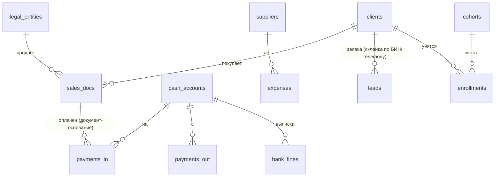

# DWH.md — хранилище хаба AIRL (демо)

Режим хаба `/airl-dwh`, репозиторий хаба, команда AIRL. Вопросы 1, 2, 5, 12, 14 закрыты картой
(`COMPANY_MAP.md`, разделы 2–5, 7). Данные — синтетические (`data/generate_1c.py`).

## Ответы на 15 вопросов
| № | Вопрос | Ответ | Кто решил |
|---|---|---|---|
| 1 | Для чего данные | экран руководителя и сервисы finance, sales, edu | карта |
| 2 | Откуда | 1С (2 базы), выписки 2 банков, amoCRM, таблица потоков | карта |
| 3 | Объём и рост | ~700 реализаций, ~5 тыс. заявок, ~1 тыс. строк выписок за 18 мес.; рост ~3 %/мес | по синтетике |
| 4 | Способ загрузки | пакетно раз в сутки: CSV → `raw_*` (COPY) → `core.load()` одной транзакцией | по умолчанию |
| 5 | Справочники | контрагенты, номенклатура (направления), счета денег, статьи затрат 1С | карта |
| 6 | Уникальные ключи | `infobase:ref` документа 1С; `UNIQUE (entity_id, doc_no)`; `line_id` строки выписки | по умолчанию |
| 7 | Типы | деньги `numeric(18,2)`, валюта `char(3)`, даты `date`, время `timestamptz` (Asia/Almaty) | module-kit |
| 8 | Нормализация | `core` — 3НФ по сущностям; `metrics` — представления и функции | по умолчанию |
| 9 | Аудит | `airl_audit` в каждой витрине (каркас модулей); `hub.journal` — входы и открытия сервисов; `core.load_log` | module-kit |
| 10 | Большие таблицы | не нужны (до 10⁶ строк за годы); индексы по датам и клиенту | по умолчанию |
| 11 | Связь хранилищ | одна база PostgreSQL, Kafka/MinIO/Airflow не нужны | по умолчанию |
| 12 | Масштабирование | вертикально; при росте — материализовать `metrics.m_*` | по умолчанию |
| 13 | Доступы и качество | пользователь на сервис; сверка модулей с `metrics` (`tests/reconcile.sql`) | карта + AIRL |
| 14 | Потребители | 3 сервиса, оболочка хаба, ИИ-слой (`ai_reader`) | карта |
| 15 | Восстановление | ночной `pg_dump`, копия в другом ДЦ РК, проверка восстановления раз в месяц (DEVOPS.md) | по умолчанию |

## Слои и сущности
| Слой | Схема | Таблицы / объекты | Кто пишет |
|---|---|---|---|
| Сырой | `raw_1c` | organizations, kontragenty, dogovory, nomenklatura, realizatsiya(+_tovary), postuplenie_rs, pko, spisanie_rs, zatraty, bank_accounts, ostatki_dc, sotrudniki | `airl_loader` |
| Сырой | `raw_bank`, `raw_amocrm`, `raw_sheets` | statement_lines; leads, amo_users; cohorts, cohort_students | `airl_loader` |
| Общие | `core` | legal_entities, clients (+client_source_map), suppliers, sales_docs, payments_in, payments_out, expenses, cash_accounts, cash_openings, bank_lines, leads, managers, cohorts, enrollments, employees, load_log | `core.load()` |
| Показатели | `metrics` | definitions (карта, раздел 4), `value()`, `status()`, `kpi_period()`, `series()`, `pnl()`, `receivables_aging()`, `lead_funnel()`, `revenue_forecast()`, `m_<id>` по месяцам, `revenue_daily`, `lead_daily`, `enrollments_daily`, `cohort_fill_rate_detail` | `metrics_owner` |
| Витрины | `mart_finance` | kit + pnl-cashflow + receivables + bank-reconciliation; адаптеры `src_pnl_entries`, `src_pnl_cash`, `src_receivables_docs`, `src_rcv_clients`, `src_bank_statement_lines`, `src_bank_open_items` | `svc_finance` |
| Витрины | `mart_sales` | kit + plan-fact; `src_pf_facts`; `sales_staff`, `lead_followups` | `svc_sales` |
| Витрины | `mart_edu` | kit; `edu_flags`, `edu_curators`, `m_edu_at_risk` | `svc_edu` |
| Хаб | `hub` | users (scrypt), journal | `svc_hub` |

Правила загрузки 1С: только проведённые без пометки удаления; продажи и затраты со своим
юрлицом — `is_intragroup`; телефон в `core.leads` не хранится — только `md5` для склейки дублей
(ВАЖНО: без соли это псевдонимизация, а не обезличивание — см. SECURITY.md). ФИО и оклады
сотрудников в `core` не попадают.

## Схема связей (core)

## Доступы (проверены атаками — SECURITY.md)
| Пользователь | Читает | Пишет |
|---|---|---|
| `airl_loader` | `raw_*` | `raw_*`, `core` (только через загрузку) |
| `metrics_owner` (без входа) | `core` | `metrics` (владелец; функции SECURITY DEFINER только на чтение) |
| `svc_finance` | `metrics`, `core.sales_docs`, `core.clients`, `core.cash_accounts`, адаптеры `src_*` | `mart_finance` |
| `svc_sales` | `metrics`, `core.leads`, `core.managers`, `src_pf_facts` | `mart_sales` |
| `svc_edu` | `metrics`, `core.cohorts`, `core.enrollments`, `core.clients(client_id, kind, name)` | `mart_edu` |
| `svc_hub` | `metrics` | `hub` |
| `ai_reader` (только чтение, 10 с) | `metrics`, `m_<…>` витрин и их `airl_settings` | — |

## Сверка с источником
- Модули против `metrics`: `tests/reconcile.sql` — 6 проверок × до 18 месяцев, расхождений 0.
- С «отчётом 1С» сверить нельзя: 1С нет. В бою — выручка закрытого месяца против ОСВ 1С по 6010.

## Миграции и восстановление
`dwh/sql/00–05` и `dwh/marts/*` — повторяемые (`IF NOT EXISTS`, `CREATE OR REPLACE`, `ON CONFLICT`):
`setup_db.sh` можно запускать повторно. Отката по файлу нет — откат хранилища = восстановление из
копии (DEVOPS.md). Модули из `skills/airl-modules` скопированы без правок в `dwh/modules/`.

## Открытые вопросы
- НЕИЗВЕСТНО: доступ к 1С AIRL (OData или выгрузка), конфигурация, программист 1С.
- ПРЕДПОЛОЖЕНИЕ: оплата привязана к реализации документом-основанием (в реальной 1С бывает по договору — тогда нужен FIFO-разнос).
- ПРЕДПОЛОЖЕНИЕ: себестоимость = прямые статьи затрат; в 1С может быть отдельный счёт 7010.
- Загрузка в демо — полная перезапись `core`; в бою — окно 45 дней и `is_deleted` для исчезнувших документов.
