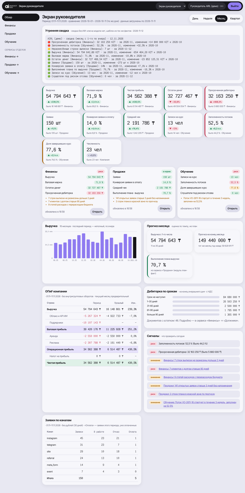

# Демо-хаб AIRL — проверка методики VibeOps на себе

Хаб руководителя для AIRL (AI Research Labs, Алматы): один вход, экран руководителя в стиле AIRL
и пять сервисов отделов — **Финансы** (ОПиУ, ДДС, должники, сверка банка), **Продажи** (воронка,
план-факт, напоминания), **Маркетинг** (расход по каналам и кампаниям, CPL, CAC, ROMI, бюджет),
**Обучение** (потоки VibeOps, риск отсева), **HR** (численность, текучесть, вакансии, онбординг, ФОТ по отделам). Собран строго по навыкам
`skills/airl-*` этого репозитория.



## Что доказывает демо
- Навыки проводят от карты компании до хаба, который принимает собственный скрипт приёмки:
  `check_service.py` → **код выхода 0** для `finance`, `sales`, `marketing`, `edu`, `hr` (локально; первые три — и в `docker compose`).
- Модули библиотеки (`pnl-cashflow`, `receivables`, `bank-reconciliation`, `plan-fact`, `onboarding`) ставятся без правок и
  дают **те же цифры**, что единые показатели `metrics` (18 месяцев, 0 расхождений); расход кабинетов и ФОТ ЗУП
  сходятся с проводками 1С за каждый закрытый месяц.
- Права «каждый пишет в свою витрину» держит база, а не код: 89 атак не прошли (вкл. подмену id, чужую витрину, ФИО и оклады).
- Цифры экрана руководителя = SQL-показатели для дня, недели, месяца, квартала (Playwright).
- Где навыки споткнулись — `SKILL_GAPS.md`; ход работы и время — `METHODOLOGY_LOG.md`.

## Что здесь синтетическое
**Все данные.** Доступа к настоящей 1С AIRL и к https://airl.kz/airl-1c-hub/ не было и не использовалось.
`data/generate_1c.py` (детерминированно, 18 месяцев до сегодняшнего дня) создаёт выгрузки в форме
1С:Бухгалтерии для Казахстана (2 юрлица: ТОО «AI Research Labs» и ТОО «AIRL Dev» с внутригрупповым
субподрядом), выписок двух вымышленных банков, amoCRM (с UTM-метками), 1С:ЗУП (начисления, отпуска, больничные), таблиц потоков,
вакансий и бюджета маркетинга, рекламных кабинетов Meta, Google и Telegram. Компании — «ТОО «Демо-…»»,
люди — «Имя И.», телефоны только +7 700 000 xx xx, БИН начинается с 9914, ИИН — с 9913 (несуществующий
месяц — не пройдут ни один реестр). Суммы, сезонность, просрочка, неразнесённые платежи и перерасход
бюджета придуманы, чтобы экраны показывали сигналы. Логотип и цвета — фирменные AIRL (с airl.kz).

## Как запустить
### Без Docker (так проверялось в песочнице)
Нужны PostgreSQL 16 (пользователь-администратор), Node.js 22, Python 3 с `psycopg`.
```bash
cd examples/airl-hub-demo
cat > .env <<'EOF'
ADMIN_DATABASE_URL='postgresql://<админ>@<хост>:5432/postgres'
DEMO_PASSWORD=<придумайте пароль демо-пользователей, от 10 знаков>
EOF
bash scripts/setup_db.sh        # роли, слои, модули, синтетика, пользователи (~2 мин); пароли баз допишет в .env
bash scripts/dev_up.sh          # оболочка :3000, сервисы :3001–3005, прокси :8080
bash ai/run_digest.sh           # утренняя сводка (без ключа модели — шаблон)
open http://127.0.0.1:8080/login
bash scripts/verify.sh          # все проверки; результаты — verification/
bash scripts/dev_down.sh
```
### Docker
```bash
bash scripts/init_env.sh            # .env со случайными паролями; пароль демо — строка DEMO_PASSWORD
docker compose up -d --build        # db → setup → hub, finance, sales, edu, hr, marketing → caddy
open http://localhost:8080/login
```
В песочнице проверены образы сервисов и стек `db + hub + finance + sales + edu` (check_service exit 0);
образ Caddy не скачался (лимит Docker Hub), контейнер `setup` не собрался (закрыто зеркало Alpine) —
см. `DEVOPS.md`.

### Статическая версия (без сервера, для показа)
`python3 scripts/build_static.py` на запущенном стенде собирает `dist-static/`: экран руководителя и все пять сервисов
на снимке данных под `ceo` — см. `static-demo/README.md`.

## Входы
Пароль у всех демо-пользователей один — `DEMO_PASSWORD` из вашего `.env` (задаётся при первом запуске,
в репозиторий не попадает).

| Логин | Роль | Что видит |
|---|---|---|
| `ceo` | руководитель | весь экран руководителя, все отделы, сводку |
| `head_finance` / `head_sales` / `head_marketing` / `head_edu` / `head_hr` | руководитель отдела | экран только своего отдела, свой сервис |
| `staff_finance` | бухгалтер | сервис «Финансы»: звонки должникам, разнос банка |
| `staff_sales` | менеджер | только свои открытые заявки |
| `staff_edu` | куратор | только свои потоки, «Отметить риск» |
| `staff_marketing` | маркетолог | аналитика каналов и кампаний; заметки — к кампаниям своих каналов (Instagram, Meta-формы) |
| `staff_hr` | HR-менеджер | онбординг своих отделов, «Готово» по пункту; без ФОТ |

## Где что лежит
| Путь | Что |
|---|---|
| `COMPANY_MAP.md`, `ARCHITECTURE.md`, `DWH.md` | карта компании, схемы, хранилище |
| `data/generate_1c.py`, `dwh/` | синтетика и SQL слоёв; `dwh/modules/` — копии модулей из `skills/airl-modules` |
| `services/hub` | оболочка: вход, экран руководителя, плитки, журнал |
| `services/{finance,sales,marketing,edu,hr}` | сервисы: `SPEC.md`, `airl.service.json`, `SECURITY.md`, `REVIEW.md`, `HUB_CHECK.md`, код |
| `services/shared` | общий каркас: проверка токена, роли, summary, токены дизайна, PWA |
| `hub/services.json`, `proxy/Caddyfile` | реестр хаба и маршруты (генерируются `scripts/gen_caddy.js`) |
| `tests/`, `verification/`, `screenshots/` | проверки, их результаты, скриншоты |
| `SECURITY.md`, `REVIEW.md`, `DEVOPS.md`, `HUB.md` | отчёты навыков |
| `METHODOLOGY_LOG.md`, `SKILL_GAPS.md` | как шли по методике и что поправить в навыках |

## Честно о том, чего нет
Нет настоящих данных, сервера в РК и домена; ничего не выложено на airl.kz. Вход — встроенный демо-издатель
JWT (в бою — Authentik с тем же контрактом). ИИ-сводка — без модели. Lighthouse и реальный телефон не проверялись.
