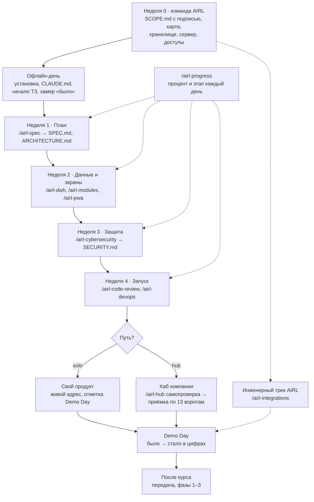

# Методология сопровождения курса VibeOps

Это карта всей методологии. Здесь видно, кто что делает, в какую неделю,
каким навыком, что появляется в репозитории (папке проекта на GitHub) и кто
проверяет, что этап пройден. Подробные шаги — в инструкциях по уровням ниже.

## Цель курса

Сотрудник компании за 4 недели превращает свою рабочую задачу в боевой продукт
(продукт, которым пользуются люди каждый день, а не демонстрационный прототип).
На Demo Day (день показа результатов) он показывает «было → стало» в цифрах:
например, «отчёт собирался 6 часов в неделю → 0 часов».

Человек отвечает на вопросы навыков (готовых инструкций для Claude). Навыки
пишут документы и код. Команда AIRL готовит данные и сервер и закрывает то,
что участнику не по силам.

## Роли

| Роль | Кто | Главное в работе | Инструкция |
|---|---|---|---|
| Участник | сотрудник компании-клиента | проходит путь от боли до продукта | [01-participant.md](01-participant.md) |
| Новичок | участник, который никогда не программировал | ставит программы и делает первые шаги | [00-novice.md](00-novice.md) |
| Тренер (куратор) | тренер курса | ведёт группу, следит за прогрессом, снимает блокеры | [02-trainer.md](02-trainer.md) |
| Инженеры AIRL | Азамат, Ержигит, Имангали | неделя 0, хранилище, сервер, хаб, приёмка, инженерный трек | [03-engineer.md](03-engineer.md) |
| Продакт-менеджер AIRL | Алмас | рамки, договор, доступы, отчёт клиенту, продление | [04-product-manager.md](04-product-manager.md) |
| Руководитель | Жанибек (CEO AIRL) и руководитель клиента | решения, сроки, цифры успеха | [05-ceo.md](05-ceo.md) |

Общие справочники:

- [glossary.md](glossary.md) — словарь терминов простыми словами;
- [troubleshooting.md](troubleshooting.md) — «если …, то …» для всех ролей;
- [checklists/](checklists/) — короткие чек-листы по неделям;
- [GAPS_FOR_SKILLS.md](GAPS_FOR_SKILLS.md) — что в навыках стоит доработать;
- `templates/<навык>/` — шаблоны документов каждого навыка (папку создаёт
  скрипт синхронизации из `skills/*/templates`; если её ещё нет, шаблоны лежат
  в папке навыка `skills/<навык>/templates/` и `skills/<навык>/references/`).

## Два пути

| | Путь 1. Свой продукт (solo) | Путь 2. Хаб компании (hub) |
|---|---|---|
| Кто | один участник со своей задачей | 2–4 человека от каждого отдела, обычно 3–4 отдела |
| Где живёт продукт | свой сервер и свой домен | сервер хаба компании, путь `hub.<домен>/<отдел>` |
| Главные документы | `SPEC.md`, `ARCHITECTURE.md` | `COMPANY_MAP.md` (карта компании), `SPEC.md` + `airl.service.json` отдела |
| Данные | своя база продукта | общее хранилище: `core`, `metrics`, витрина `mart_<отдел>` |
| Вход | свой, на готовом провайдере | только через хаб |
| Финал | живой адрес и `- [x] Demo Day` в `SPEC.md` | сервис принят в хаб, `HUB_CHECK.md`: «подключён» |
| Неделя 0 для AIRL | почти не нужна: доступы и установка | обязательна: карта, хранилище, сервер, вход |

Навыки сами понимают путь: есть карта компании — работают как часть хаба,
нет — ведут отдельный продукт.

## Путь по неделям

| Неделя | Навыки (по порядку) | Что появляется в репозитории | Этап пройден, если | Кто проверяет |
|---|---|---|---|---|
| 0 · Подготовка | AIRL: `/airl-spec` A0 и A, `/airl-devops`, `/airl-dwh`, `/airl-integrations` (опись) | хаб: `SCOPE.md` с подписью, `COMPANY_MAP.md`, `DEVOPS.md`, `DWH.md` | `SCOPE.md` подписан; доступ к 1С есть; обезличенная копия готова | PM Алмас, инженеры |
| Офлайн-день | установка, `/airl-context`, начало `/airl-spec` | `CLAUDE.md`, репозиторий на GitHub | этап «Старт» ≥ 75% в `/airl-progress` | тренер |
| 1 · План | `/airl-spec` (S или B), `/airl-architecture-extra` (если нужно), `/airl-modules` (подбор) | `SPEC.md`, `ARCHITECTURE.md`; хаб: `airl.service.json`, `airl/COMPANY_MAP.md` | цена боли и метрика с числом, 3+ критерия | тренер; в хабе — владелец карты |
| 2 · Данные и экраны | `/airl-dwh`, `/airl-modules` (установка), `/airl-connect` (если «купить»), `/airl-pwa` | `DWH.md`, миграции, модуль, манифест PWA, service worker, `/healthz`; хаб: `/api/hub/summary` | этап «Данные» ≥ 75% | тренер; доступ к данным — инженер |
| 3 · Защита | `/airl-cybersecurity` | `SECURITY.md` с вердиктом | «Можно открывать людям: да» | тренер; права в хранилище — инженер |
| 4 · Запуск | `/airl-code-review`, `/airl-devops`, `/airl-ai` (по желанию), хаб: `/airl-hub самопроверка` | `REVIEW.md`, `Dockerfile`, `.github/workflows/`, `DEVOPS.md`, `AI.md`, `HUB_CHECK.md` | блокирующих замечаний 0; `/healthz` отвечает 200 | тренер; приёмка в хаб — инженер |
| Demo Day | хаб: `/airl-hub готовность` | `SPEC.md`: `- [x] Demo Day`; хаб: `HUB_CHECK.md` «подключён» | показ «было → стало» в цифрах | руководитель клиента, Жанибек |
| После курса | `/airl-devops` (ранбуки), `/airl-spec` C3, `/airl-integrations` | обновлённый `DEVOPS.md`, очередь фаз 1–3 | передача: доступы, копии, контакт поддержки | PM, инженеры |

Каждый навык читает документы предыдущих и не спрашивает то же самое второй раз.
Поэтому порядок важен.

## Схема курса

Сплошные стрелки — путь участника. Пунктир — работа, которая идёт параллельно:
инженерный трек и ежедневная проверка прогресса.

## Как это связано с /airl-progress

`/airl-progress` (навык для тренеров) раз в день смотрит репозиторий каждого
участника. Он ничего не меняет, только читает список файлов и несколько
документов. Из этого он считает процент и этап.

| Этап | Вес в проценте | Пункты (id из чек-листа навыка) |
|---|---|---|
| Старт | 5 | `repo`, `claude_md` |
| План | 20 | `spec`, `spec_pain`, `spec_metric`, `spec_criteria`, `arch_context`; хаб: `service_json`, `company_map` |
| Данные | 25 | `dwh`, `migrations`, `module`, `pwa_manifest`, `pwa_sw`, `healthz`; хаб: `hub_summary` |
| Защита | 15 | `security_md`, `security_ok` |
| Запуск | 25 | `docker`, `ci`, `devops_md`, `review_ok`, `live` |
| Demo Day | 10 | `demo` |

- **Этап пройден**, если выполнено 75% его пунктов с учётом весов.
- **Текущий этап** — первый не пройденный по порядку. Перепрыгнуть нельзя.
- **План курса**: 5% в день старта, 25% к концу недели 1, 50% — недели 2,
  65% — недели 3, 90% — недели 4, 100% — к Demo Day.
- **Флаги**: «застрял N дн.» (4 дня без коммитов или без роста), «отстаёт»
  (ниже плана на 15 пунктов), «впереди» (выше на 10), «нет доступа».

Чек-листы в этой папке совпадают с пунктами навыка. Полное описание —
`skills/airl-progress/references/checklist.md`, веса —
`skills/airl-progress/templates/weights.yml`.

Важно: процент показывает, какие файлы есть в репозитории. Это не оценка
человека. Тренер всегда смотрит и содержание (например, что цена боли
настоящая, а не выдуманная).

## Как читать инструкции

- Начинаете с нуля — сначала [00-novice.md](00-novice.md), потом
  [01-participant.md](01-participant.md).
- Ведёте группу — [02-trainer.md](02-trainer.md) и
  [troubleshooting.md](troubleshooting.md).
- Инженер — [03-engineer.md](03-engineer.md).
- Продаёте и ведёте клиента — [04-product-manager.md](04-product-manager.md).
- Принимаете решения — [05-ceo.md](05-ceo.md).

Навыки называются в тексте коротко: `/airl-spec`. При установке плагином
команда выглядит так: `/airl:airl-spec`. Это одно и то же.
