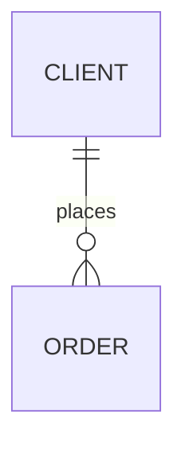

# База данных и хранилище — «[Название продукта или сервиса]»

**Режим**: [свой продукт / хаб: общее хранилище / хаб: витрина отдела [id]] ·
**Дата**: [ГГГГ-ММ-ДД] · **Основная база**: [PostgreSQL версия] · **Данные для разработки**:
[синтетика / обезличенная копия / тестовое хранилище хаба]
<!-- Пишет /airl-dwh после «да» на структуру. Без эмодзи. Значения ключей и строки
     подключения не пишутся — только имена переменных. Каждое решение помечай:
     «выбрано человеком» или «по умолчанию». Не знаешь — «НЕИЗВЕСТНО: что именно». -->

## 1. Ответы на вопросы
<!-- 15 обязательных тем. Закрытые картой или ТЗ — «из карты» / «из SPEC.md, раздел N». -->
| № | Тема | Ответ | Как решено |
|---|---|---|---|
| 1 | Для чего данные | [работа приложения / отчёты / оба] | [человеком / по умолчанию / из карты] |
| 2 | Откуда приходят | [источники: формат, владелец, частота] | [как решено] |
| 3 | Сущности | [см. раздел 2] | [как решено] |
| 4 | Объём и рост | [строк сейчас, в день, сколько лет хранить] | [как решено] |
| 5 | Способ загрузки | [приложение пишет само / пакетно раз в N минут / поток] | [как решено] |
| 6 | Справочники | [см. раздел 3] | [как решено] |
| 7 | Уникальные ключи | [см. раздел 4] | [как решено] |
| 8 | Типы хранения | [деньги — numeric, время — с поясом в UTC, файлы — вне базы] | [как решено] |
| 9 | Нормализация | [чистое ядро / ядро и звезда для отчётов / плоские] | [как решено] |
| 10 | Аудит и история | [кто и когда — везде; полная история — где] | [как решено] |
| 11 | Большие таблицы | [нет / деление по времени: таблица, поле] | [как решено] |
| 12 | Разные хранилища | [одна база / какие ещё и как связаны] | [как решено] |
| 13 | Рост | [запас: индексы, пользователь для отчётов; 3 тяжёлых запроса] | [как решено] |
| 14 | Доступы и качество | [пользователи базы, проверки в базе, закон о хранении] | [как решено] |
| 15 | Потребители и восстановление | [кто читает, задержка, копия перед миграцией] | [как решено] |

## 2. Сущности
| Таблица | Назначение | Поля и типы | Ограничения |
|---|---|---|---|
| `[схема.таблица]` | [зачем] | [поле тип, …] | [PK, FK, NOT NULL, CHECK] |

## 3. Справочники
| Справочник | Значения | Растёт? | Кто меняет |
|---|---|---|---|
| `[таблица]` | [значения] | [да / нет] | [роль] |

## 4. Уникальные ключи
| Таблица | Бизнес-ключ | Защита от дублей при повторной загрузке |
|---|---|---|
| `[таблица]` | [поля] | [UNIQUE (источник, id в источнике)] |

## 5. Аудит и история
[`created_at/by`, `updated_at/by` во всех таблицах; полная история — в `[таблица]`;
мягкое удаление — где; сколько хранить журнал]

## 6. Большие таблицы и сроки хранения
[нет / таблица, поле деления, сколько частей держать, автоудаление]

## 7. Схема связей

## 8. NoSQL
[не нужна: PostgreSQL с JSONB справляется / ответы на вопросы N1–N6]

## 9. Потоки данных между системами
<!-- Хаб: как забираем из 1С, CRM, таблиц — способ, частота, окно перечитывания,
     сверка показателя с источником. Свой продукт: внешние API — что берём, как часто,
     что при ошибке и лимите, где ключ (имя переменной). -->
| Источник | Способ | Частота | Куда | Что при сбое | Сверка |
|---|---|---|---|---|---|
| [1С / CRM / API / CSV] | [OData / API / выгрузка файлом / временно CSV] | [раз в сутки / 15 мин] | `[raw_… / таблица]` | [повтор без дублей] | [что сверяем, дата] |

## 10. Доступы и роли
| Пользователь базы | Кто | Права |
|---|---|---|
| `[app / svc_<отдел>]` | приложение | [чтение и запись своих таблиц; не администратор] |
| `[loader]` | загрузка | [запись в raw/core] |
| `[ai_reader / hub_reader]` | ИИ-слой, хаб | только чтение показателей |

Персональные данные: [какие колонки, где маска] · обезличивание тестовых данных проверено:
[запрос по каждой колонке `pii`, дата] · страна хранения: [страна]

## 11. Миграции и восстановление
Миграции: [папка, инструмент, как применить, как проверить] · копия перед миграцией:
[команда] · восстановление проверено: [дата / ещё нет]

## 12. Открытые вопросы
- НЕИЗВЕСТНО: [что именно, кто выясняет, к какой дате]
- ПРЕДПОЛОЖЕНИЕ: [что допустили]
