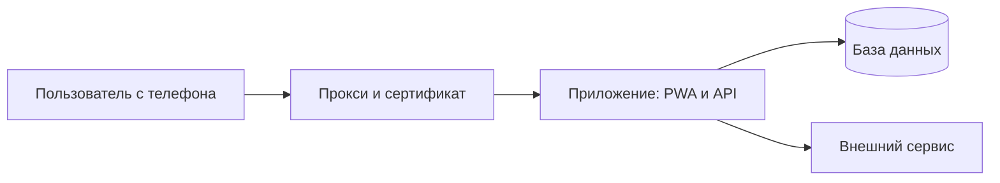

<!-- Шаблон схемы архитектуры своего продукта. Пишет /airl-spec (режим S);
     дополняют /airl-architecture-extra, /airl-dwh и /airl-devops — каждый в своём разделе
     и в общем блоке airl-context внизу, второй блок не создаётся.
     Технологии выбирай по лестнице: уже оплачено → бесплатное → дешёвое → платное.
     Цены — с пометкой «уточнить на сайте провайдера». -->

# Архитектура продукта «[Название]»

## Что строим
[одна фраза из SPEC.md, раздел 1]

## Страна и закон
<!-- Из skills/airl-spec/references/country.md. Казахстан по умолчанию не подставлять. -->
| Что | Значение |
|---|---|
| Страна данных | [KZ / UZ / другая] |
| Закон о персональных данных | [название] — проверить у юриста |
| Где хранить данные | [в стране / без требований] |
| Особые данные (`sensitive`) | [нет / да: какие] |
| Валюта | [код и знак] |
| Телефон, идентификаторы | [формат] |
| Языки интерфейса | для сотрудников: [языки] · для клиентов: [языки] |

## Ответы на базовые вопросы
| Вопрос | Ответ |
|---|---|
| Пользователей в первые полгода | [до 100 / до 1000 / больше] |
| Какие данные храним | [обычные / персональные / особые / платёжные] |
| Вход | [нет / для своих / Google, Microsoft / для клиентов] |
| Оплата внутри продукта | [нет / позже / сразу] |
| Бюджет в месяц | [сумма] [валюта] |
| Уже есть и оплачено | [домен, сервер, аккаунты / ничего] |

## Технологии
| Что | Чем делаем | Почему | Цена сейчас | Цена при росте |
|---|---|---|---|---|
| Интерфейс (PWA) | [фреймворк] | [почему] | [цена] | [цена] |
| Серверная часть и API | [фреймворк] | [почему] | [цена] | [цена] |
| База данных | PostgreSQL [версия] | [почему] | [цена] | [цена] |
| Вход и роли | [провайдер] | [почему] | [цена] | [цена] |
| Сервер и домен | [провайдер VPS, домен] | [почему] | [цена] | [цена] |

**Итого в месяц**: [сумма] [валюта] — уточнить на сайтах провайдеров

## Схема
<!-- Обязательные схемы — по references/diagrams.md: контекст, структура, поток данных.
     Подписи простым языком. -->


## Что решили не делать в первой версии
- [что и почему]

## Контекст для следующих шагов
<!-- Блок читают все следующие навыки и /airl-progress (строка mode: обязательна).
     Значения через « | » — выбери одно. Ключи ниже черты дописывают другие навыки. -->
```yaml
# airl-context
mode: solo
users_6m: "[до 100]"
country: [KZ | UZ | другая]
currency: [KZT | UZS | другая]
languages: [ru]
data_kind: [ordinary | personal | sensitive | payment]
login: [none | staff | clients | both]
payment: [none | later | now]
budget_month: [число]
already_have: [домен, сервер]
hosting: vps                 # vps | platform; в курсе по умолчанию vps
level: 2                     # 1 | 2 | 3
services: ["app: интерфейс и API"]
external_apis: []            # например [amoCRM]
maintainer: [self-novice | self-experienced | team | contractor]
# ниже — по умолчанию; меняет /airl-architecture-extra
components: []               # cache, files, queue, scheduler
data_organization: single-db # single-db | per-service-db | shared-db-schemas | shared-legacy
needs_dwh: false
service_communication: requests
downtime_ok: hours           # hours | minutes | none
data_loss_ok: day            # day | hour | none
observability: logs-only
# дописывает /airl-dwh
database: postgresql         # тип основной базы
nosql: []                    # например [redis]
orchestrator: none           # none | cron | airflow
# дописывает /airl-devops
provider: ""                 # провайдер сервера
deploy: ""                   # manual | ci
escalation_contact: ""       # кому звонить при аварии (имя, без телефона в git — где найти)
unknowns: []
```
