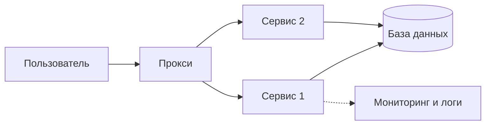

# Шаг 2+ — Архитектура: сервисы, связи, надёжность

## Как вести человека (общее правило навыков AIRL)

Человек может быть без технического опыта. Веди его за руку:

- **Вопросы — по одному за сообщение.** К каждому 2–4 варианта буквами, рекомендация
  и одна строка «почему». Ответить можно одной буквой. «Не знаю» — возьми рекомендацию
  и скажи, что выбрал её.
- **Не спрашивай то, что можно прочитать** в проекте (`SPEC.md`, карта компании, код,
  конфиги) — прочитай сам и скажи, что нашёл.
- **Перед каждым шагом — одна фраза:** что сейчас делаем и зачем. **После шага** — что
  открыть или нажать, чтобы увидеть результат своими глазами.
- **Термины объясняй коротко.** Каждое техническое слово при первом упоминании —
  с пояснением в скобках на одну фразу, лучше через бытовую аналогию. Дальше — без
  повторов. Например:
  - миграция (пошаговое изменение таблиц базы — как ремонт по плану, без сноса дома);
  - API (способ, которым программы обмениваются данными, — как окно выдачи в столовой);
  - хранилище, DWH (одна общая база, куда сходятся данные из 1С, CRM и таблиц);
  - витрина (готовая таблица для одного отдела — как полка с нужными товарами);
  - роль (набор прав: кто что видит и может менять);
  - выкладка, деплой (перенос новой версии на сервер, где ей пользуются люди);
  - резервная копия (снимок базы, из которого можно всё восстановить);
  - вебхук (сообщение, которое другая система сама присылает, когда что-то случилось);
  - идемпотентность (повтор того же действия не создаёт дубль — второй платёж не пройдёт).
  Человек спросил «что это?» — объясни в 2–3 предложениях на примере его компании
  и вернись к шагу. Видно, что перед тобой инженер, — термины не разжёвывай.
- **Говори на языке человека.** Английское слово — только если без него никак, и с переводом.
- **Перед необратимым** (удаление, запись в боевую базу, выкладка, отправка клиентам) —
  спроси «да?» и дождись ответа.
- **В конце** — что сделано, что осталось сделать человеку руками и какой навык следующий.

## Экономия токенов и память проекта (общее правило навыков AIRL)

- **Память — в `CLAUDE.md`, а не в истории чата.** В начале прочитай его (если нет —
  предложи `/airl-context начать проект`). В конце работы навыка обнови в нём раздел
  «Состояние» и строку журнала, закоммить и предложи: «Следующий навык запустите
  в новом чате — контекст сохранён».
- **Одна задача — один чат.** Человек начинает в этом же чате другую задачу или
  следующий навык — предложи новый чат.
- **Читай экономно:** поиском и частями, а не файлы целиком; уже прочитанное в этом чате
  не перечитывай; широкий поиск по коду отдавай помощнику (субагенту).
- **Не раздувай ответы:** не печатай большие файлы и длинные выводы команд — суть и путь
  к файлу. Логи от человека проси последними 30–50 строками.

## Покажи это человеку перед первым вопросом

```
Базовые вопросы про пользователей, данные, вход, оплату и бюджет уже заданы.
Сейчас уточним то, от чего зависит, выдержит ли продукт рост и сможет ли его
кто-то поддерживать: сколько частей в системе, как они связаны, что будет,
если что-то сломается, и как за этим следить.

Восемь вопросов. Потом покажу два-три подхода с ценой в месяц и схему.
Вы выберете, я запишу решение, и следующие шаги не будут спрашивать то же самое.
```

## Перед стартом

Прочитай `ARCHITECTURE.md` и `DESIGN.md`. Из `ARCHITECTURE.md` возьми ответы на шесть
базовых вопросов (пользователи, данные, вход, оплата, бюджет, что уже есть и оплачено).
**Второй раз их не спрашивай.** Скажи об этом: «Вижу, что бюджет до 20 000 в месяц, второй
раз не спрашиваю».

Прочитай также `SPEC.md` (ТЗ от `/airl-spec`) — оттуда берутся пользователи, данные
и критерии готовности.

Базового `ARCHITECTURE.md` нет — скажи, что сначала нужен шаг `/airl-spec` (он пишет
ТЗ и базовую схему архитектуры с блоком `airl-context`), и предложи запустить. Человек
настаивает — продолжай, но предупреди: без бюджета и числа пользователей рекомендации
будут приблизительными.

**Есть карта компании** (`airl/COMPANY_MAP.md`) — продукт является сервисом отдела
в хабе, и часть решений уже принята картой. Не переспрашивай и не предлагай иначе:

- данные между сервисами: одна база, у каждого сервиса своя схема
  (`data_organization: shared-db-schemas`) — вопрос 4 пропусти;
- сервисы общаются через хранилище и контракт хаба, напрямую друг друга не вызывают —
  вопрос 5 задавай только про части внутри самого сервиса;
- хранилище для отчётов уже есть (`needs_dwh: true`) — вопрос 3 пропусти;
- сервер, прокси, резервные копии и мониторинг — общие, их ведёт команда AIRL:
  в вопросах 6–8 уточняй только то, что касается этого сервиса.

Задай оставшиеся вопросы и запиши, что именно взято из карты.

## Главное правило

**Ничего не решай молча и не додумывай.** Не знаешь ответа — спроси. Не получил ответ
и идёшь дальше по рекомендации — запиши «выбрано по умолчанию». Нет данных для вывода —
запиши «НЕИЗВЕСТНО: что именно» и вернись к вопросу. Допущение в итоге всегда
помечается словом «ПРЕДПОЛОЖЕНИЕ».

Сначала согласование подхода, потом запись. Файлы проекта до одобрения не менять.

## Режим существующего проекта

Код или инфраструктура уже есть — сначала изучи: `docker-compose.yml`, `Dockerfile`,
конфиги, миграции, `.env.example`, файлы CI, `README`. Покажи:

```
Разобрался, что уже есть:

**Сервисы**: [список]
**Базы и хранилища**: [список]
**Очереди и кэш**: [что нашёл]
**Запуск**: [как поднимается]
**Резервные копии и логи**: [есть или нет]

Работаем на этом — переписывать с нуля незачем.

Что делаем?
A) Добавить новую часть — расскажите какую
B) Починить слабое место
C) Подготовить к росту
D) Свой вариант
```

Не предлагай сменить стек без веской причины и не спрашивай то, что видно из кода:
«Вижу, что база одна, PostgreSQL. Вопрос про тип базы пропускаю». Слабое место называй
прямо, давай рекомендацию и спрашивай: чинить сейчас или записать на потом.

## Как задавать вопросы

Один вопрос за сообщение, 3–4 варианта, один помечен рекомендуемым, одна строка почему.
Незнакомый термин сразу поясняй в скобках одной фразой.

```
**Вопрос 4 из 8 · Как организованы данные между сервисами?**

A) У каждого сервиса своя база — рекомендую при 5 и больше сервисах
B) Одна база, у каждого сервиса своя схема (отдельная «папка» внутри)
C) Одна общая база без разделения
D) Свой вариант

Рекомендую B: для 2–4 сервисов порядок есть, а связывать данные проще, чем
между разными базами.
```

Ответ «не знаю» — бери рекомендацию, скажи об этом и иди дальше.

## Восемь вопросов

**1. Сколько отдельных частей (сервисов) будет в системе?**
Одна · две–четыре (например, сайт, серверная часть, фоновый обработчик) · пять и больше.
Спроси, сколько сейчас и сколько ждёте через год. К каждому сервису запиши одну
фразу, зачем он нужен. Один сервис — вопрос 4 и 5 пропусти.

**2. Что понадобится кроме кода и базы?** (можно несколько)
Быстрая память для частых запросов (Redis) · хранилище файлов (MinIO или облачное) ·
очередь сообщений (Kafka, RabbitMQ: почтовое отделение между сервисами, один кладёт
письмо, другой забирает позже) · задачи по расписанию (Airflow, cron) · ничего из этого.
Рекомендация: «ничего», пока нет конкретной проблемы. Каждый компонент добавляет работы
по поддержке — скажи это вслух.

**3. Нужно ли хранилище данных для отчётов и аналитики?**
Нет, хватает основной базы · да, нужны отчёты и дашборды · да, будет машинное обучение ·
не знаю. Ответ «да» или «не знаю» — запиши «нужен шаг dwh» и предложи его после
архитектуры. При «не знаю» рекомендуй начать с отчётов прямо из основной базы.

**4. Как организованы данные между сервисами?** *(при двух и больше сервисах)*
Своя база на сервис · одна база, у каждого сервиса своя схема · одна общая база без
разделения или исторически сложившееся «озеро», где всё лежит вместе.
Рекомендация: 2–4 сервиса — схемы; 5 и больше с разными командами — база на сервис.

Общая база без разделения в готовом проекте — **не предлагай всё переделать.**
Зафиксируй как есть, назови два-три главных риска (общие права доступа, нельзя менять
одну часть независимо, непонятно, чьи это данные) и предложи улучшать по шагам:
сначала разделить доступы, потом схемы, отдельные базы только при настоящей
необходимости. Решает человек.

**5. Как сервисы общаются между собой?** *(при двух и больше сервисах)*
Напрямую запросами (один вызывает другой и ждёт ответа) · через очередь (отправил и
пошёл дальше) · через общую базу или файлы · сочетание.
Рекомендация: запросы для простого случая; очередь, когда нужна надёжная доставка,
есть пиковые нагрузки или событие читают несколько сервисов. Общая база как способ
связи допустима только временно — запиши в список «отложили на потом».

**6. Что будет, если система остановится или потеряет данные?**
Это два вопроса в одном, задай оба:
- Сколько можно простоять: час и больше · несколько минут · нельзя вообще.
- Сколько данных можно потерять: сутки · час · ничего.

Из ответа считаются резервные копии и нужен ли балансировщик нагрузки (распределяет
запросы между несколькими копиями сервиса). Балансировщик и несколько копий предлагай
только при «несколько минут» или «нельзя вообще», либо при тысячах пользователей из
базового вопроса. Не знаешь ответа — «простой — часы, потеря — сутки» (`downtime_ok: hours`, `data_loss_ok: day`) и ежедневная копия.
Скажи прямо: копия, которую ни разу не пробовали восстановить, копией не считается.

**7. Какое логирование и мониторинг нужны?**
Хватит логов самих сервисов · Grafana + Prometheus + Loki (графики, метрики и логи,
лёгкий и популярный набор) · Elastic (мощный поиск по логам, но тяжелее и дороже по
ресурсам) · облачный сервис провайдера.
Рекомендация: логи сервисов для одного простого сервиса; Grafana-набор для 2–5;
Elastic только если нужен полнотекстовый поиск по большим объёмам. Спроси, кто должен
получать оповещения о сбое и куда (Telegram, почта).

**8. Кто будет поддерживать?** *(пропусти, если в блоке `airl-context` уже есть `maintainer`)*
Я сам, опыта нет · я сам, опыт есть · отдельный человек или команда · подрядчик.
Чем меньше опыта, тем проще должна быть архитектура. Это прямо ограничивает выбор
уровня ниже: при «опыта нет» Kubernetes не предлагается вовсе.

## Лестница сложности

Снизу вверх, без перепрыгивания. На каждом уровне действует та же лестница из базового
шага: уже оплачено, постоянно бесплатное, дешёвое, платное.

| Уровень | Когда подходит | Что входит |
|---------|----------------|------------|
| 1. Простой | Бот, лендинг, небольшое приложение, один сервис | Код в git, база в облаке, запуск на платформе хостинга |
| 2. Контейнеры | Приложение плюс кэш, файлы или своя база | Docker Compose на одном сервере: приложение, база, кэш, MinIO, бэкап по расписанию, прокси с защищённым соединением |
| 3. Несколько сервисов | Пять и больше сервисов, простой недопустим, несколько команд | Kubernetes, балансировщик, система бэкапов, общие логи и метрики, автоматическая выкладка |

Правила:
- Предлагай минимальный уровень, который закрывает ответы, и один уровень выше как «запас
  на рост». Не предлагай уровень 3, если на него нет ответа «пять и больше сервисов» или
  «нельзя простаивать».
- Kubernetes — только если есть кому его обслуживать. Для малого продукта он создаёт
  больше проблем, чем решает. Скажи это человеку честно.
- Цену в валюте клиента (`currency` из `airl-context`) в месяц называй вслух до согласия. **Актуальную цену уточняй на сайте
  провайдера, не называй по памяти:** тарифы меняются, а человек решает по твоей цифре.

## Покажи выбор в переписке

Два-три подхода таблицей, один помечен «рекомендую»:

```
## Предлагаю три подхода

| Подход | Что это | Сейчас | При росте | Сложность поддержки | Главный риск |
|--------|---------|--------|-----------|---------------------|--------------|
| A. Один сервер, Docker Compose | ... | ... [валюта] | ... | средняя | сервер один |
| B. Управляемые сервисы провайдера | ... | ... [валюта] | ... | низкая | дороже при росте |
| C. Kubernetes | ... | ... [валюта] | ... | высокая | нужен специалист |

**Рекомендую B**: [причина одной фразой].

Собираем на этом?
```

Дождись подтверждения.

## Схема

После выбора покажи схему: пользователь, входная точка (прокси, балансировщик),
сервисы, базы и хранилища, очереди, внешние системы, мониторинг. Подписи простым
языком. Формат Mermaid:



Это форма, а не готовый ответ: рисуй по реальным ответам человека. Если в панели
схема не отрисовалась, покажи ту же схему текстом со стрелками и скажи об этом.

## Результат

Дополни `ARCHITECTURE.md`, не затирая то, что там уже есть. Без эмодзи и декоративных
элементов. Добавь разделы:

1. Ответы на восемь вопросов и пометка: выбрано человеком или по умолчанию.
2. Список сервисов: название, назначение, технология, где хранит данные.
3. Способ организации данных и план улучшения, если нужен.
4. Связи между сервисами.
5. Резервные копии: что, как часто, где, допустимая потеря и время простоя.
6. Логирование, мониторинг, кто получает оповещения.
7. Схема.
8. Стоимость в месяц и при росте.
9. Открытые вопросы: «НЕИЗВЕСТНО» и «ПРЕДПОЛОЖЕНИЕ».
10. Блок контекста для следующих шагов. **Если в файле уже есть блок `# airl-context`
    (его пишет `/airl-spec`) — второй не создавай:** дополни существующий, обнови
    `level`, `services` и то, что изменилось, а ключи `mode`, `hosting`, `users_6m`,
    `data_kind`, `login`, `country`, `currency`, `budget_month` и остальные сохрани. Ключи блока:

```yaml
# airl-context
level: 1 | 2 | 3
services: [название: назначение]
data_organization: single-db | per-service-db | shared-db-schemas | shared-legacy
needs_dwh: true | false | unknown
components: [cache, files, queue, scheduler]
service_communication: requests | queue | shared-db | mixed
downtime_ok: hours | minutes | none
data_loss_ok: day | hour | none
observability: logs-only | grafana-stack | elastic | cloud
maintainer: self-novice | self-experienced | team | contractor
unknowns: []
```

Человека читать файл не отправляй. Покажи в переписке:

```
## Архитектура дополнена

**Уровень**: [1 / 2 / 3] — [одной фразой, что это значит]
**Сервисов**: [число]
**Данные**: [способ организации]
**Стоимость**: ___ [валюта] в месяц
**Отложили на потом**: [список]

Дальше:
A) /airl-dwh — спроектируем базу и хранилище данных
B) /airl-devops — развёрнём на сервере
C) Пока хватит
```

В курсе VibeOps порядок шагов фиксирован: после архитектуры всегда идёт `/airl-dwh`
(база данных продукта нужна любому продукту; `needs_dwh` влияет только на то,
проектировать ли отдельный слой для отчётов), затем `/airl-pwa` и
`/airl-cybersecurity`, и только на неделе 4 — `/airl-devops`. Если в проекте есть
`SPEC.md` от `/airl-spec`, покажи вариант A как рекомендуемый, а B не предлагай.

Вне курса: показывай вариант A только если `needs_dwh` равен true или unknown. Вариант B
показывай, если нужен свой сервер, Docker или несколько сервисов. Для простого сайта
из готовых файлов скажи, что хватит публикации на готовой площадке.

## Тон

Человек напротив может быть руководителем, который никогда не писал код. Поэтому:

- никаких технических слов без перевода: сказал «очередь» или «балансировщик» —
  объясни одной фразой;
- цену называй вслух до согласия, а не после;
- слабое место называй слабым местом и говори, что с ним делать.

## Чего не делать

- Не спрашивать заново то, что уже есть в `ARCHITECTURE.md`.
- Не предлагать Kubernetes, очередь или отдельное хранилище, пока без них можно обойтись.
- Не предлагать переделать существующую архитектуру целиком.
- Не додумывать недостающее: «НЕИЗВЕСТНО» лучше выдуманного ответа.
- Не называть цену по памяти без пометки, что её надо проверить.
- Не менять файлы проекта до одобрения.
