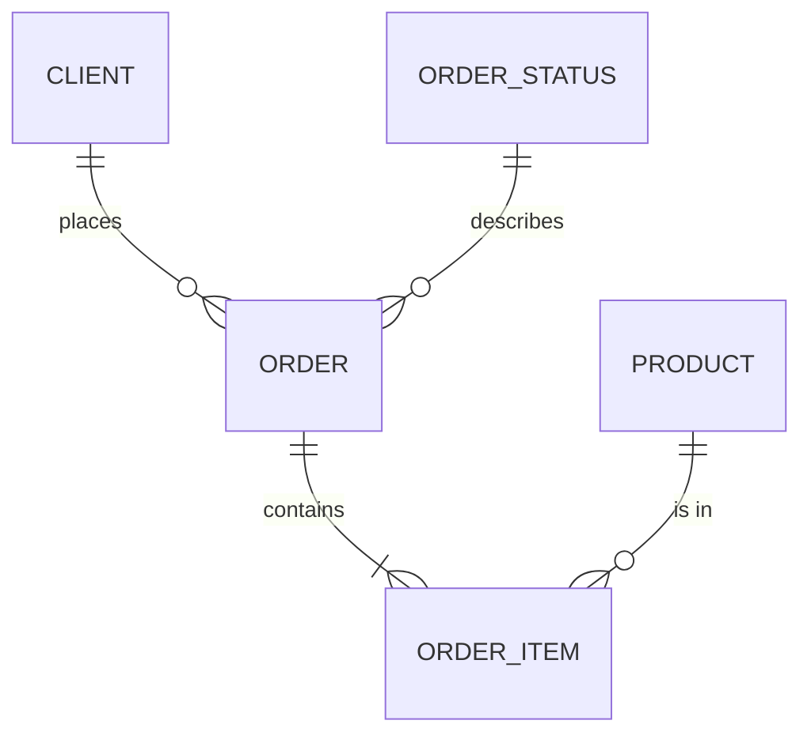

# Шаг 2+ — Данные: как устроить базу и хранилище

## Как вести человека (общее правило навыков AIRL)

Человек может быть без технического опыта. Веди его за руку:

- **Вопросы — по одному за сообщение.** К каждому 2–4 варианта буквами, рекомендация
  и одна строка «почему». Ответить можно одной буквой. «Не знаю» — возьми рекомендацию
  и скажи, что выбрал её.
- **Не спрашивай то, что можно прочитать** в проекте (`SPEC.md`, карта компании, код,
  конфиги) — прочитай сам и скажи, что нашёл.
- **Перед каждым шагом — одна фраза:** что сейчас делаем и зачем. **После шага** — что
  открыть или нажать, чтобы увидеть результат своими глазами.
- **Термины объясняй коротко.** Каждое техническое слово при первом упоминании —
  с пояснением в скобках на одну фразу, лучше через бытовую аналогию. Дальше — без
  повторов. Например:
  - миграция (пошаговое изменение таблиц базы — как ремонт по плану, без сноса дома);
  - API (способ, которым программы обмениваются данными, — как окно выдачи в столовой);
  - хранилище, DWH (одна общая база, куда сходятся данные из 1С, CRM и таблиц);
  - витрина (готовая таблица для одного отдела — как полка с нужными товарами);
  - роль (набор прав: кто что видит и может менять);
  - выкладка, деплой (перенос новой версии на сервер, где ей пользуются люди);
  - резервная копия (снимок базы, из которого можно всё восстановить);
  - вебхук (сообщение, которое другая система сама присылает, когда что-то случилось);
  - идемпотентность (повтор того же действия не создаёт дубль — второй платёж не пройдёт).
  Человек спросил «что это?» — объясни в 2–3 предложениях на примере его компании
  и вернись к шагу. Видно, что перед тобой инженер, — термины не разжёвывай.
- **Говори на языке человека.** Английское слово — только если без него никак, и с переводом.
- **Перед необратимым** (удаление, запись в боевую базу, выкладка, отправка клиентам) —
  спроси «да?» и дождись ответа.
- **В конце** — что сделано, что осталось сделать человеку руками и какой навык следующий.

## Экономия токенов и память проекта (общее правило навыков AIRL)

- **Память — в `CLAUDE.md`, а не в истории чата.** В начале прочитай его (если нет —
  предложи `/airl-context начать проект`). В конце работы навыка обнови в нём раздел
  «Состояние» и строку журнала, закоммить и предложи: «Следующий навык запустите
  в новом чате — контекст сохранён».
- **Одна задача — один чат.** Человек начинает в этом же чате другую задачу или
  следующий навык — предложи новый чат.
- **Читай экономно:** поиском и частями, а не файлы целиком; уже прочитанное в этом чате
  не перечитывай; широкий поиск по коду отдавай помощнику (субагенту).
- **Не раздувай ответы:** не печатай большие файлы и длинные выводы команд — суть и путь
  к файлу. Логи от человека проси последними 30–50 строками.

## Покажи это человеку перед первым вопросом

```
Прежде чем писать код, решим, как устроены данные: что хранится, как связано,
что вынести в справочники, что не должно повторяться, где нужна история
изменений и как это будет расти.

Задам 15 вопросов, по одному, с готовыми вариантами. Потом покажу таблицы и схему
связей. Код и миграции пишу только после вашего «да».

Ошибку в структуре данных исправить дороже всего: данные уже лежат, а менять
таблицы под ними долго. Поэтому тратим на это 20 минут сейчас.
```

## Перед стартом

Прочитай по порядку, чего нет — пропусти:

1. `airl/COMPANY_MAP.md` или `COMPANY_MAP.md` — карта компании. **Есть карта — работай
   в режиме хаба** (раздел ниже): половина вопросов уже решена картой.
2. `SPEC.md` — ТЗ продукта от `/airl-spec`: сущности, что продукт читает и записывает,
   персональные данные, критерии готовности.
3. `ARCHITECTURE.md`, блок `airl-context`, и `DESIGN.md`: какие данные хранятся (обычные
   или персональные), способ организации данных между сервисами, нужны ли очередь,
   файловое хранилище и расписание, допустимая потеря данных.

**Второй раз не спрашивай.** Скажи: «Вижу, что данные персональные и допустимая потеря
час, это учту. Вопрос про потери пропускаю».

Нет ни `SPEC.md`, ни `ARCHITECTURE.md` — спроси только то, без чего нельзя идти дальше,
и предложи потом запустить `/airl-spec`.

**Свой продукт (карты нет), `SPEC.md` есть.** Часть вопросов уже закрыта ТЗ — не
задавай их с нуля, а покажи, что прочитал, и попроси только поправить:

- вопрос 2 (откуда данные) — `SPEC.md` раздел 7 «Внешние сервисы и API»;
- вопрос 3 (сущности) — раздел 5: покажи таблицу сущностей из ТЗ и спроси, чего
  не хватает;
- вопрос 14 (роли и персональные данные) — разделы 2 и 9;
- вопросы 11–13 (большие таблицы, разные хранилища, рост) при «до ста» или «до
  тысячи пользователей» и одном приложении закрой по умолчанию вслух: одна база
  PostgreSQL, делить таблицы и добавлять хранилища не нужно.

Скажи человеку честно, сколько вопросов осталось, а не «15».

## Главное правило

**Ничего не решай молча и не додумывай.** Нет данных — запиши «НЕИЗВЕСТНО: что именно»
и вернись к вопросу. Допущение помечай «ПРЕДПОЛОЖЕНИЕ». Ответ «не знаю» — бери
рекомендацию и записывай «выбрано по умолчанию».

Сначала согласование структуры, потом (только после явного «да») черновик SQL и
миграций. До согласования файлов с кодом не создавай.

**Реальные персональные данные в разработку не попадают.** Выгрузки из 1С, CRM,
МИС с настоящими людьми не кладутся в папку проекта и не открываются в этом чате:
всё, что ты видишь, уходит во внешнюю модель ИИ. Для разработки и проверки —
синтетические или обезличенные данные той же формы: имена, телефоны,
идентификаторы физлиц и e-mail заменены, суммы, даты и связи настоящие.
Проверка на настоящих данных — только на сервере клиента, запросом, который
возвращает число строк или сумму, а не сами записи. Увидел в проекте файл
с похожими на настоящие ФИО и телефонами — остановись, скажи человеку и предложи
удалить его из папки и из истории git.

Страна, валюта и особые данные — из раздела «Страна и закон» в `ARCHITECTURE.md`
или раздела 1 карты. Для особых данных (`sensitive`: здоровье, биометрия, дети):
в базе только то, без чего не работает главный экран; особые поля — в отдельной
таблице с доступом по списку ролей; журнал просмотров карточки обязателен.

## Режим существующего проекта

Найди схему: миграции, модели ORM, SQL-файлы, дампы. Покажи таблицей, что нашёл:

```
Разобрался, как устроены данные:

**База**: [тип]
**Таблиц**: [число], главные: [список]
**Связи**: [есть внешние ключи / нет]
**Справочники**: [вынесены / строками в таблицах]
**История изменений**: [есть / нет]

Работаем на этом — переписывать структуру с нуля незачем.

Что делаем?
A) Добавить новые таблицы под новую возможность
B) Починить слабые места
C) Подготовить к росту объёма
D) Свой вариант
```

Слабые места называй прямо, без нотаций: нет внешних ключей, повторяющиеся данные,
JSON вместо таблиц, нет индексов по частым фильтрам, нет уникальных ограничений.
К каждому дай рекомендацию и спроси, чинить сейчас или записать «на потом».
Не меняй существующую структуру без согласия.

## Режим хаба (есть карта компании)

Карта уже решила: откуда данные (раздел 2), как склеивается клиент (3), как считаются
показатели (4), какие слои и кто куда пишет (5), роли и персональные данные (7).
Эти вопросы **не задавай заново** — вопросы 1, 2, 5, 12 и 14 закрыты картой, скажи
об этом вслух. Дальше зависит от того, где ты находишься.

**Репозиторий хаба, команда AIRL — общее хранилище, один раз на компанию.**

| Слой | Схема | Что в нём | Кто пишет |
|------|-------|-----------|-----------|
| Сырой | `raw_<система>` | данные как пришли из 1С, Bitrix24, amoCRM, таблиц | только загрузка |
| Общие данные | `core` | очищенные сущности, справочники, одна карточка клиента | только загрузка |
| Показатели | `metrics` | представления строго по определениям раздела 4 карты | только команда AIRL |
| Витрины | `mart_<отдел>` | данные сервиса отдела | только сервис отдела |

- Загрузка из каждой системы — пакетная по расписанию, повторный запуск не создаёт
  дублей (ключ источника плюс уникальное ограничение). 1С, Bitrix24 и amoCRM только
  читаются: в них ничего не записывается, они работают как раньше. Частота —
  по самому требовательному сервису: отчёты — раз в сутки, напоминания и действия
  «на сегодня» — каждые 5–15 минут.
- Источник правды — сервис хаба (раздел 2 карты, «сервис `<id>`»): загрузка
  копирует подтверждённые записи его витрины в `core`; копии этой витрины —
  не реже раза в час; история изменений обязательна.
- Тестовое хранилище для отделов — **обезличенная копия** (см. «Главное правило»).
  Обезличивание проверь запросом по каждой колонке из `pii` всех `airl.service.json`
  и запиши результат в `DWH.md`.

**Загрузка из 1С** — почти всегда главный риск хаба:

1. Спроси: конфигурация и версия, сколько баз (часто по базе на юрлицо), где стоит
   (офис, облако 1С:Фреш, хостинг), кто программист 1С и сколько часов он даст.
2. Способ, по порядку предпочтения: стандартный интерфейс OData (публикация на
   внутреннем веб-сервере, отдельный пользователь 1С только на чтение) →
   HTTP-сервис (пишет программист 1С) → регламентное задание, которое выгружает
   файлы на сервер хаба по SFTP. Прямое чтение SQL-базы 1С не предлагай.
3. 1С в офисе в интернет не публикуется: туннель WireGuard от сервера 1С до сервера
   хаба или выгрузка, которую 1С отправляет сама.
4. Берём только проведённые документы без пометки удаления. Документы правят задним
   числом: каждый день перечитывай окно не меньше 45 дней (или до даты запрета
   редактирования); исчезнувшие помечай `is_deleted`, а не удаляй.
5. Несколько баз — один `raw_1c` с полем `infobase`; продажи между юрлицами группы
   помечаются как внутригрупповые.
6. Себестоимость в 1С часто считается при закрытии месяца — скажи владельцу
   `gross_profit` до того, как он увидит «ноль» за текущий месяц.
7. Запиши в карту, когда будет доступ. Нет доступа к концу недели 0 — красный флаг
   для PM: курс в варианте хаба не начинается.

Отраслевые системы без API (МИС, производственные программы, Cropster на тарифе
без API) — та же логика: официальный API → регулярная выгрузка файлом → ручная
выгрузка как временный путь с честной пометкой, насколько данные опаздывают.
- Карточка клиента: ключи склейки из раздела 3 карты, таблица соответствий
  «клиент в `core` ↔ запись в системе-источнике», спорные совпадения — в отдельную
  таблицу на разбор человеку, а не склеиваются молча.
- Каждый показатель — одно представление `metrics.<id>` с тем же `id`, что в карте.
  Формула, дата, НДС, исключения — дословно из карты. Определение в карте неполное —
  не додумывай: запиши «НЕИЗВЕСТНО» и верни вопрос владельцу карты (`/airl-spec`).
- На каждый показатель — сверка с источником правды за закрытый период (например,
  выручка за прошлый месяц против отчёта 1С). Расхождение — находка, а не погрешность.
- Пользователи базы: `svc_<отдел>` на каждый сервис (читает `core` и `metrics`, пишет
  только в `mart_<отдел>`), отдельный на загрузку, отдельный на хаб (только чтение).
  Общего администратора сервисам не выдавать.
- Заполни в карте колонку «Как забираем» раздела 2, уточни раздел 5 и заполни
  в разделе 8 «Среду для разработки»: как отдел получает строку подключения
  к тестовому хранилищу. Заполнение этих ячеек версию карты не меняет. Менять
  определения показателей и состав разделов здесь нельзя — это `/airl-spec`, режим A2.
- Хранилище должно быть готово с тестовыми данными **до недели 2** отделов:
  без него отдел не сможет ни спроектировать витрину, ни собрать экраны.

**Репозиторий сервиса отдела — только витрина.**

1. Возьми из `SPEC.md` раздел 5: что сервис читает и что записывает.
2. Нужна строка подключения к тестовому хранилищу под пользователем `svc_<отдел>`
   (раздел 8 карты, «Среда для разработки»). Её нет — **остановись и скажи человеку,
   что запросить у команды AIRL**; не поднимай вместо хранилища свою пустую базу
   и не выдумывай таблицы `core`. Пока ждёте, можно спроектировать витрину на бумаге.
   Проверь, что всё нужное есть в `core` и `metrics`. Нет — это запрос команде AIRL
   и владельцу карты, а не повод ходить в 1С или CRM напрямую и не повод считать
   показатель своей формулой.
3. Спроектируй таблицы `mart_<отдел>`: по вопросам 3, 6, 7, 8, 10 — остальные решены
   картой. Ссылки на клиентов и сделки — по ключам `core`, без копирования их полей.
4. Подключение из кода — пользователем `svc_<отдел>`, строка подключения только из
   переменных окружения. Слой доступа к данным — в одном месте кода, чтобы
   `/airl-pwa` заменил заглушки одной правкой.
5. Запиши результат в `DWH.md` и отметь неделю 2 в `SPEC.md` раздел 12.

## Как задавать вопросы

Один вопрос за сообщение, 3–4 варианта, один помечен рекомендуемым, одна строка почему.
Незнакомый термин поясняй в скобках одной фразой.

```
**Вопрос 9 из 15 · Насколько чисто разделять данные (нормализация)?**

A) Максимально чисто, без повторов — для работы приложения, рекомендую
B) Чистое ядро плюс упрощённые таблицы под отчёты
C) Простые плоские таблицы для быстрого старта
D) Свой вариант

Рекомендую A: данные не расходятся, а отчёты можно добавить позже отдельными
таблицами, не трогая основу.
```

## Пятнадцать вопросов

**1. Для чего нужны данные?**
Для работы приложения (заказы, пользователи, операции) · для отчётов и аналитики ·
для того и другого. Рекомендация при «и то и другое»: разделить, чтобы тяжёлые отчёты
не тормозили приложение.

**2. Откуда придут данные?** (можно несколько)
Действия пользователей · внешние сервисы и API · файлы (CSV, Excel, выгрузки) ·
другие базы компании. На каждый источник запиши: формат, владелец, как часто
обновляется, насколько ему можно доверять.

**3. Какие основные сущности?**
Попроси перечислить «предметы» системы своими словами (клиент, заказ, товар, платёж).
Затем предложи таблицу: сущность, главные поля, связи (один ко многим, многие ко
многим). Покажи и попроси поправить.

**4. Какой объём и как он растёт?**
До миллиона строк · до ста миллионов · больше ста миллионов или сотни гигабайт · не
знаю. Дополнительно: сколько прибавляется в день и сколько лет хранить. От ответа
зависят деление больших таблиц, выбор движка и цена.

**5. Как данные попадают в базу?**
Пишет само приложение сразу · пакетная загрузка по расписанию · поток событий (Kafka) ·
копирование изменений из другой базы (CDC).
Сначала спроси, что продукт делает по этим данным и как быстро. Отчёты — раз
в сутки. Напоминания и действия «на сегодня» (запись к врачу, доставка) — данные
не старше 5–15 минут: пакетная загрузка с таким шагом. Если источник отдаёт только
ручную выгрузку — скажи прямо, что напоминания будут опаздывать до следующей
выгрузки, и запиши это в `SPEC.md`.
Рекомендация: пакетная загрузка в большинстве случаев. Поток и CDC только когда
задержка в минуты недопустима.

**6. Какие поля принимают ограниченный набор значений (справочники)?**
Предложи кандидатов по сущностям: статусы, типы, категории, страны, валюты, роли.
Для каждого спроси: список закрытый или будет расти? нужна ли история изменений
значения? нужны ли переводы? кто добавляет новые значения? Рекомендация: небольшие
стабильные списки хранить в справочных таблицах, чтобы значение нельзя было записать с
опечаткой.

**7. Что должно быть уникальным?**
Что однозначно определяет запись в бизнесе (номер договора, номер медкарты,
регистрационный номер юрлица, артикул)? Телефон — не уникален: в семье или
компании один номер у нескольких людей; как ключ — только вместе с датой рождения
или фамилией. Государственный номер физлица — только если он уже собирается.
Может ли оно измениться или повториться? Нужна ли защита от дублей, когда одни и те же
данные загружают второй раз? Рекомендация: у каждой таблицы технический ключ плюс
уникальный бизнес-ключ там, где он есть. Запиши все уникальные ограничения.

**8. Какого типа хранение нужно по каждой группе данных?**
Пройди по группам и зафиксируй выбор:

| Данные | Рекомендация |
|--------|--------------|
| Деньги | Точное десятичное число, не дробное с плавающей точкой. Валюта отдельным полем |
| Дата и время | С часовым поясом, хранить в UTC |
| Большие файлы и изображения | Не в базе: в файловом хранилище, в базе ссылка и описание |
| Поля с переменной структурой | JSONB, только если структура действительно меняется |
| Персональные и платёжные данные | Выделить отдельно, решить, шифровать ли и кто видит |
| Длинные тексты и логи | Отдельная таблица или хранилище |

**9. Насколько чисто разделять данные (нормализация)?**
Максимально чисто, без повторов (третья нормальная форма) · чистое ядро плюс
упрощённые таблицы под отчёты (звезда: факты и измерения) · простые плоские таблицы.
Рекомендация: первый вариант для работы приложения, второй для аналитики, третий
только для прототипа и с записью в «отложили на потом». Объясни выбор на таблицах
человека.

**10. Нужна ли история изменений и таблицы аудита?**
История не нужна · нужно знать, кто и когда создал и изменил запись · нужна полная
история значений · нужна только по ключевым сущностям и справочникам.
Уточни: нужно ли «мягкое удаление» (запись помечается удалённой, а не стирается),
есть ли требования регулятора к журналу действий, сколько хранить аудит.
Рекомендация: «кто и когда» для всех таблиц, полная история только для финансовых и
чувствительных, чтобы не раздувать базу.

**11. Будут ли очень большие таблицы, которые надо делить на части?**
Нет, всё поместится · есть растущие таблицы событий, операций или логов, делим по
времени (партиционирование) · нужно распределять по нескольким серверам
(шардирование) · не знаю.
Рекомендация: первые два варианта. Шардирование усложняет всё, брать только когда одна
база физически не справляется. Для второго варианта определи, по какому полю делить и
сколько частей держать.

**12. Будут ли разные хранилища и как они общаются?**
Одна база · несколько баз разных типов (PostgreSQL, Redis, ClickHouse) · база плюс
файловое хранилище плюс очередь (Kafka, MinIO) · нужен оркестратор загрузок (Airflow:
забирает данные из источников, чистит, складывает в хранилище).
Для каждой связки запиши: какая система источник истины для каких данных, как данные
переходят из одной в другую, что делать при сбое посреди загрузки (повтор без
дублей), кто следит за расписанием. Развёртывание Airflow и баз передай шагу
`/airl-devops`, схему связей между сервисами — шагу `/airl-architecture-extra`.

**13. Как это будет расти?**
Рост не ожидается · вырастет в разы, хватит более мощного сервера · нужны копии для
чтения, чтобы отчёты не тормозили основную базу · нужно распределённое решение ·
не знаю. Рекомендация: заложить второй вариант и возможность третьего (индексы,
отдельный пользователь для отчётов). Запиши три самых частых и самых тяжёлых запроса.

**14. Кто и как получает доступ, и какое качество нужно?**
Кто работает с данными (приложение, аналитики, подрядчики)? Какие роли (чтение, запись,
администратор)? Есть ли персональные или платёжные данные и требования закона о
хранении в стране? Нужно ли скрывать часть полей от аналитиков? Какие проверки
(не пусто, диапазон, формат, связь с родительской записью)?
Рекомендация: отдельный пользователь базы на каждый сервис и на аналитиков, права по
минимуму, проверки как ограничения в самой базе, а не только в коде. Требования
закона записывай как «проверить у юриста».

**15. Кто читает данные и как восстанавливать?**
Кто читает: BI-инструмент, API, машинное обучение, выгрузки в Excel? Какая допустима
задержка: минуты, час, сутки? Как делаются изменения структуры (миграции) и как их
откатывать? Рекомендация: миграции в git, свежая копия базы перед каждой миграцией,
восстановление проверено хотя бы раз.

## Слои хранилища

Если в вопросе 1 есть отчёты и аналитика, предложи слои:

| Слой | Что хранит | Правило |
|------|------------|---------|
| Сырой | Данные как пришли из источника | Не менять, нужен для перезагрузки |
| Очищенный | Проверенные данные, справочники | Единая версия правды |
| Витрины | Таблицы под конкретные отчёты | Можно пересоздать в любой момент |

Для простых проектов рекомендуй два слоя вместо трёх и объясни: лишний слой — лишняя
работа.

## Когда нужна NoSQL

Задай проверочный вопрос после вопроса 4 и ещё раз после вопроса 12:

```
**Нужно ли что-то из этого?** (можно несколько)

A) Данные, структуру которых неудобно описать таблицами (документы)
B) Очень быстрая запись или чтение по ключу (сессии, кэш, счётчики)
C) Поиск по тексту в больших объёмах
D) Данные в виде сети связей (рекомендации, цепочки, структура владения)
E) Метрики и временные ряды в больших объёмах
F) Нет, обычной базы достаточно — рекомендую

Рекомендую F: PostgreSQL с полем JSONB закрывает большинство задач с гибкой
структурой, и поддерживать одну базу проще, чем две.
```

Ответ F — иди дальше без NoSQL. Ответ A–E — пройди шесть вопросов ниже, каждый ответ
запиши.

**N1. Почему не подходит обычная база?**
Попроси назвать конкретную проблему. Покажи таблицей сравнение для этого случая:
PostgreSQL с JSONB против выбранной NoSQL — по сложности, цене поддержки, надёжности,
гибкости. Выигрыш неочевиден — рекомендуй остаться на обычной базе.

**N2. Какой тип хранилища?**

| Задача | Обычно выбирают |
|--------|-----------------|
| Кэш, сессии, счётчики | Redis |
| Документы с гибкой структурой | MongoDB |
| Поиск по тексту, логи | Elasticsearch или OpenSearch |
| Метрики и временные ряды | TimescaleDB, ClickHouse, Prometheus |
| Сеть связей | Neo4j |
| Огромная запись с распределением по узлам | Cassandra |

Выбери один инструмент. Второй — только если есть причина.

**N3. Как будут читать данные?**
По ключу, по набору фильтров, поиском по тексту, агрегациями? NoSQL проектируется под
конкретные запросы. Запиши 3–5 главных запросов и структуру под них.

**N4. Что критичнее: актуальность или доступность?**
Можно ли потерять последние секунды записей? Для кэша да, для платежей нет. Платёжные
и учётные данные в NoSQL без веской причины не переноси.

**N5. Где главная копия и как данные синхронизируются?**
Если данные дублируются между обычной базой и NoSQL, запиши: что главное, как
синхронизируется, как исправлять расхождение, что делать при сбое синхронизации.

**N6. Срок хранения, копии и поддержка?**
Сколько хранить (автоудаление)? Как делаются копии и репликация именно этого
хранилища, у каждого свои способы? Кто обслуживает? Опыта нет — рекомендуй
управляемую версию от провайдера и назови цену в валюте клиента в месяц, предупредив, что её надо
уточнить на сайте провайдера.

## Покажи структуру в переписке

После вопросов покажи таблицами, не файлом:

```
## Предлагаю такую структуру

**Сущности**
| Таблица | Назначение | Главные поля | Ключ | Уникально |
|---------|-----------|--------------|------|-----------|
| ... | ... | ... | ... | ... |

**Справочники**
| Справочник | Значения | Кто меняет |
|------------|----------|------------|

**История и аудит**: [что и как]
**Деление больших таблиц**: [если нужно]

Схема связей: [Mermaid]

Согласны с такой структурой?
```

Схема связей в формате Mermaid:



Это форма, а не готовое решение: рисуй по сущностям человека. Не отрисовалась в панели —
покажи текстом со стрелками и скажи об этом. Дождись подтверждения.

## Результат

Запиши `DWH.md` без эмодзи и декоративных элементов:

1. Ответы на 15 вопросов и пометка: выбрано человеком или по умолчанию.
2. Сущности: таблица, назначение, поля, типы, ограничения.
3. Справочники и правила их изменения.
4. Уникальные ключи.
5. Аудит и история.
6. Деление больших таблиц и сроки хранения.
7. Схема связей.
8. Блок NoSQL, если проходили.
9. Потоки данных между системами, если вопрос 12 не про одну базу.
10. Доступы и роли.
11. Миграции и восстановление.
12. Открытые вопросы: «НЕИЗВЕСТНО» и «ПРЕДПОЛОЖЕНИЕ».

Дополни блок `airl-context` в `ARCHITECTURE.md`: тип базы, есть ли хранилище для
отчётов, есть ли NoSQL, нужен ли оркестратор. Файла нет — создай только этот блок.

Покажи в переписке:

```
## Структура данных готова

**Основная база**: [тип]
**Таблиц**: [число], справочников: [число]
**История изменений**: [где ведётся]
**Дополнительные хранилища**: [список или нет]
**Отложили на потом**: [список]

Дальше:
A) Подготовить миграции и подключить базу к продукту — рекомендую, затем сразу B
B) /airl-pwa — собрать экраны на этих данных
C) Пока хватит
```

Рекомендуй A: без него `/airl-pwa` соберёт экраны на заглушках, а задача недели 2 —
продукт, который получает и сохраняет настоящие данные. Сервер (`/airl-devops`)
на этом шаге не предлагай: он идёт на неделе 4, после `/airl-cybersecurity`.
Исключение — команда AIRL в репозитории хаба: ей после структуры нужен именно
`/airl-devops`, чтобы развернуть хранилище.

Без явного «да» на вариант A код не пиши.

### Вариант A: подключить к продукту

1. Миграции — файлами в git, по одной на изменение, каждая с откатом.
2. Примени на **локальной или тестовой** базе, не на боевой. Покажи наблюдаемо:
   какой командой применить и каким запросом увидеть созданные таблицы. Локальной
   базы у человека нет — подними её сам: PostgreSQL той же версии, что будет на
   сервере, в Docker (дай команду целиком и скажи, что нужен Docker Desktop) или
   бесплатная тестовая база в облаке **без настоящих данных клиентов**.
3. Слой доступа к данным — в одном месте кода: функции под запросы из `SPEC.md`,
   запросы параметризованные, строка подключения из переменной окружения,
   `.env` в `.gitignore`, имена переменных — в `.env.example` без значений.
4. Продукту нужны внешние сервисы через API (CRM, платежи, рассылки, модель ИИ) —
   для каждого запиши в `DWH.md`: что берём, как часто, что делаем при ошибке и
   лимите запросов, где лежит ключ. Вызовы — только с сервера, не из браузера.
   **И напиши саму загрузку**, а не только описание: получение доступа по ключу
   из переменной окружения, загрузка по расписанию или по кнопке, запись без
   дублей (по ключу источника), журнал ошибок. Проверь на тестовой записи
   в тестовом аккаунте сервиса; если тестового аккаунта нет — проверь на сервере
   клиента запросом, который возвращает число загруженных строк, а не сами записи.
   Доступа к API пока нет — не останавливайся: сделай загрузку из выгрузки CSV
   или Excel как временный путь и запиши в `SPEC.md` раздел 12 задачу «получить
   доступ к API» с датой. В хабе этот пункт не применяется: 1С и CRM читает только
   общая загрузка хранилища.
5. Проверка: запиши и прочитай запись через слой доступа (короткий скрипт или
   тест) и покажи её в базе; перезапусти и убедись, что запись на месте. Экраны
   уже есть — проверь то же самое через продукт; экранов ещё нет — это сделает
   `/airl-pwa` в своей части 2.
6. Отметь неделю 2 в `SPEC.md` раздел 12: что подключено, что на временном пути.

## Тон

Человек напротив может быть руководителем, который никогда не писал код. Поэтому:

- никаких технических слов без перевода: сказал «нормализация» или «партиционирование» —
  объясни одной фразой и примером на его таблицах;
- не показывай все 15 вопросов списком, только по одному;
- слабое место называй слабым местом и говори, что с ним делать.

## Чего не делать

- Не спрашивать заново то, что уже есть в `SPEC.md` и `ARCHITECTURE.md`.
- Не писать SQL и миграции до согласия на структуру.
- Не предлагать NoSQL, пока PostgreSQL с JSONB справляется.
- Не предлагать шардирование и отдельное хранилище «на вырост» без причины.
- Не менять существующую структуру без согласия.
- Не хранить файлы и изображения внутри базы.
- Не хранить деньги в числах с плавающей точкой.
- Не печатать в переписку реальные данные пользователей и значения ключей.
