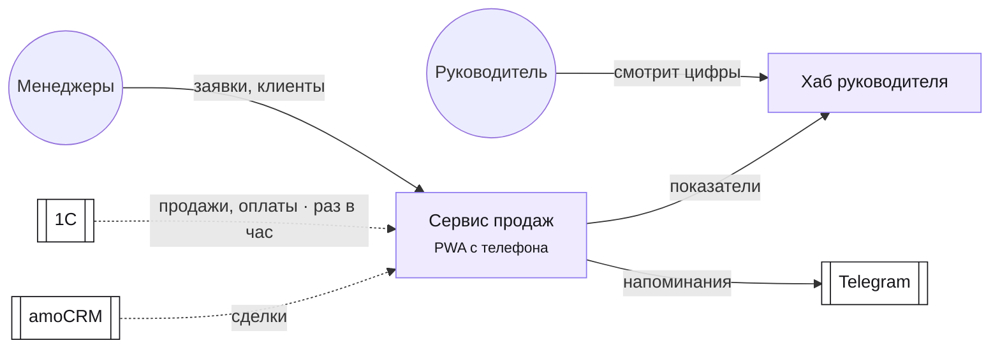
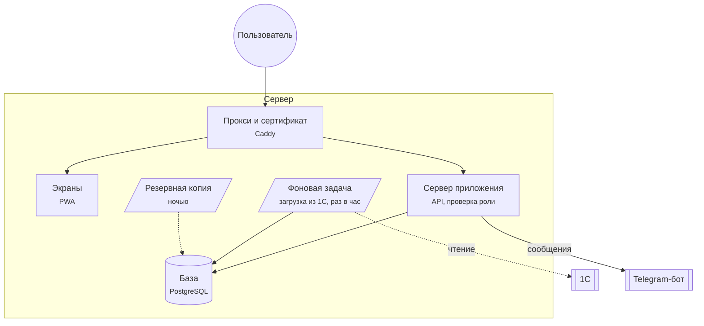
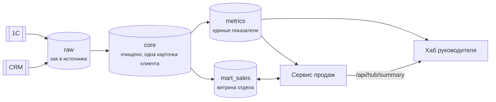
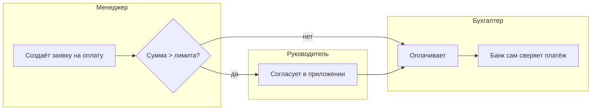
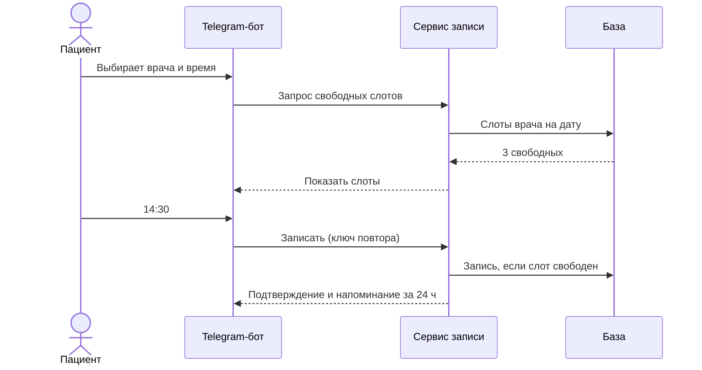
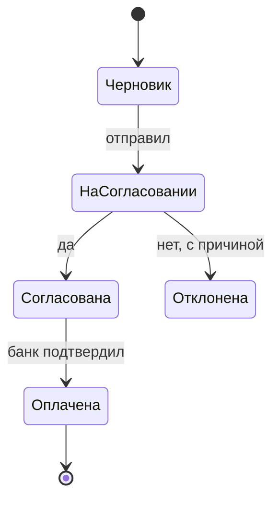

# Схемы продукта: блок-схемы архитектуры и структуры

Схема показывает продукт за 10 секунд: руководителю — что с чем связано, разработчику —
из чего собирать, на Demo Day — «было → стало». Рисуем в **Mermaid** (язык схем текстом:
GitHub и VS Code показывают его картинкой прямо в `.md`), поэтому схема живёт рядом с ТЗ,
меняется одной строкой и не теряется в Figma или на фото доски.

## Когда рисовать

- **Всегда в конце режимов S, B и A**: обязательный набор ниже → в `ARCHITECTURE.md`
  (в карте компании — в `COMPANY_MAP.md`).
- **В режиме P**: шаги 11 (ER), 12 (путь пользователя), 17 (экраны), 18 (технический
  дизайн) — по этому файлу.
- **По просьбе** («нарисуй схему», «блок-схема», «покажи архитектуру картинкой»,
  «диаграмма») — в любой момент: прочитай документы проекта и нарисуй без лишних вопросов.

## Набор схем

Обязательные отмечены ★. Остальные — когда есть что показать.

| # | Схема | Что показывает | Для кого | Mermaid |
|---|---|---|---|---|
| 1 ★ | **Контекст** | продукт в центре, кто им пользуется, с какими системами связан | руководитель, все | `flowchart LR` |
| 2 ★ | **Структура продукта** (блок-схема частей) | из каких частей собран: экраны, API, база, бот, фоновые задачи, прокси, хранилище | разработчик, DevOps | `flowchart TB` с `subgraph` |
| 3 ★ | **Поток данных** | откуда данные приходят, где хранятся, куда уходят: 1С → хранилище → сервис → хаб | руководитель, данные | `flowchart LR` |
| 4 | **Бизнес-процесс** | шаги процесса по ролям «было → стало» | отдел, руководитель | `flowchart LR` с `subgraph` на роль |
| 5 | **Путь пользователя** | экраны и переходы | дизайнер | `flowchart LR` |
| 6 | **Модель данных** | сущности и связи | разработчик | `erDiagram` |
| 7 | **Главный сценарий по шагам** | кто кому что отправляет (вход, оплата, интеграция) | разработчик | `sequenceDiagram` |
| 8 | **Статусы** | жизнь заявки, заказа, записи | все | `stateDiagram-v2` |
| 9 | **Хаб компании** (режим A) | отделы, их сервисы, слои хранилища, хаб руководителя | руководитель, команда AIRL | `flowchart TB` |

## Правила, чтобы схему понял непрограммист

1. **Подписи простым языком**: «Приложение для менеджеров (телефон)», а не «React SPA».
   Технология — второй строкой мелко, если нужна: `A["Приложение для менеджеров<br/><small>PWA</small>"]`.
2. **Не больше 12–15 блоков** на схему. Больше — раздели на две.
3. **Одинаковые фигуры для одинакового**:
   - люди — `(( ))` круг · экран или приложение — `[ ]` · база данных — `[( )]` ·
     внешняя система (1С, банк, CRM) — `[[ ]]` · фоновая задача или очередь — `[/ /]` ·
     решение или проверка — `{ }`.
4. **Стрелки подписаны глаголом**: `-->|заявка|`, `-->|раз в час|`, `-.->|только чтение|`.
   Пунктир — чтение или «необязательно», сплошная — запись или основной путь.
5. **Цвета по смыслу** (через `classDef`), с легендой под схемой:
   новое в курсе — фиолетовый, уже есть у компании — серый, внешнее — белый с рамкой,
   после курса — штрихованная рамка.
6. **Направление чтения** слева направо (`LR`) для потоков, сверху вниз (`TB`) для слоёв.
7. **Под каждой схемой — 2–3 предложения** «как читать», и что на ней важно.
8. **Схема = правда**: не рисуй того, чего нет в ТЗ и `ARCHITECTURE.md`. Будущее — отдельным
   цветом «после курса».

```text
classDef new fill:#efeafe,stroke:#8f7bf0,color:#16161a
classDef have fill:#f1f1f4,stroke:#9a9aa8,color:#16161a
classDef ext fill:#ffffff,stroke:#16161a,color:#16161a
classDef later fill:#ffffff,stroke:#9a9aa8,stroke-dasharray:4 3,color:#79798e
```

## Образцы

### 1. Контекст



Как читать: фиолетовое строим в курсе, белое — системы компании; пунктир — только читаем.

### 2. Структура продукта



### 3. Поток данных (хаб)



### 4. Бизнес-процесс «было → стало»



### 7. Главный сценарий по шагам



### 8. Статусы



## Проверь, что схема рисуется

Ошибка синтаксиса — и вместо картинки человек увидит текст. Перед сохранением проверь
каждую схему одним из способов:

```bash
npx -y @mermaid-js/mermaid-cli@11.4.2 -i ARCHITECTURE.md -o /tmp/arch-check.md
```

(команда находит все блоки `mermaid` в файле и рисует их в SVG рядом; ошибка — с номером
строки). Если она не находит браузер, укажи свой Chrome или Chromium файлом настроек:
`echo '{"executablePath":"<путь к chrome>","args":["--no-sandbox"]}' > pp.json` и добавь
`-p pp.json`. Нет Node — открой файл на GitHub или в VS Code с предпросмотром Markdown
и посмотри глазами. Частые ошибки: скобки и кавычки внутри подписи без `"…"`,
`end` как слово в подписи, пробел в id блока.

## Показать людям: страница со схемами

Для руководителя и Demo Day собери `docs/diagrams.html` — одна страница, все схемы
проекта с подписями «как читать». Mermaid подключи из CDN с точной версией
(`https://cdn.jsdelivr.net/npm/mermaid@11.4.1/dist/mermaid.min.js`), схемы вставь
в `<pre class="mermaid">`. Открывается двойным щелчком, печатается в PDF из браузера.
Нужна картинка для презентации — тот же `mermaid-cli` с `-o schema.png -s 2`.

## Обновляй схемы вместе с продуктом

Изменилась архитектура (новый сервис, база, интеграция) — поправь схему в том же
коммите. Схема, которая врёт, хуже, чем никакой. `/airl-architecture-extra`,
`/airl-dwh`, `/airl-devops` и `/airl-hub` дополняют схемы своими частями, а не рисуют
новые рядом.
