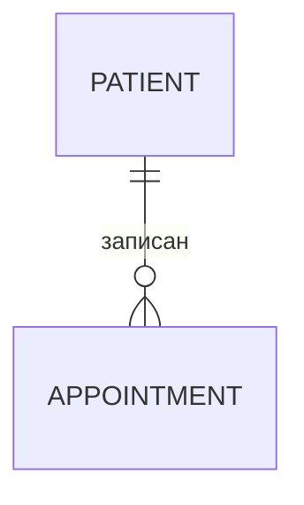

# Шаблоны режима P: PRD FINAL и бэклог

## PRD_FINAL.md

~~~markdown
---
prd_version: 1.0
status: черновик | на согласовании | утверждён
updated: ГГГГ-ММ-ДД
owner: [владелец продукта]
approved_by: [кто утвердил, дата]
map_version: [для сервиса хаба]
---

# PRD — [Название продукта]

## 0. Коротко
Одна страница: решение, для кого, какая боль в цифрах, гипотеза, MVP, срок, топ-3 риска.

## 1. Контекст и видение
Стратегия компании · окружение (системы, каналы) · формула видения · горизонт · ограничения.

## 2. Предпосылки и альтернативы
| Вариант | Цена | Срок | Риск | Польза | Итог |
|---|---|---|---|---|---|
Выбрано: … потому что …
| ID | Предположение | Как проверим | К какой дате | Статус |
|---|---|---|---|---|

## 3. Гипотеза ценности
Мы верим, что … · Метрика: baseline → цель за срок · Метод · Выборка · Критерий остановки.

## 4. Целевая аудитория
| SEG | Сегмент | Размер | Контекст | Как сейчас | Цифровой уровень | Язык | Роль |
|---|---|---|---|---|---|---|---|
Первичный сегмент: …

## 5. Проблема и цель
Боль в цифрах · стоимость в месяц · ценность по сегментам · почему сейчас · почему мы ·
North Star и опорные метрики · что не делаем (non-goals).

## 6. Jobs to be Done
| JTBD | Сегмент | Работа | Тип | Результат | Важность | Удовлетворённость |
|---|---|---|---|---|---|---|

## 7. Job Stories
| JS | Когда … я хочу … чтобы … | JTBD | Частота | Как сейчас |
|---|---|---|---|---|

## 8. Функциональные требования
| FR | Система должна … | JS | Роль | Корзина | MoSCoW | RICE |
|---|---|---|---|---|---|---|

## 9. Нефункциональные требования
| NFR | Категория | Требование (измеримо) | Как проверим |
|---|---|---|---|

## 10. ИИ в продукте
| AI | FR | Задача | Почему ИИ | Что уходит в модель | Кто подтверждает | Если модель ошиблась | Проверка | Потолок затрат |
|---|---|---|---|---|---|---|---|---|

## 11. Модель данных

| ENT | Сущность | Ключевые поля | Источник | Схема | ПДн | Хранение | История | Объём/мес |
|---|---|---|---|---|---|---|---|---|

## 12. Путь пользователя (CJM)
| Этап | Действие | Точка контакта | Мысли/эмоции | Боль | Возможность (FR) | Метрика |
|---|---|---|---|---|---|---|

## 13. Критерии приёмки
### FR-1 …
- AC-1.1 Дано … когда … тогда …
- AC-1.2 (негативный) Дано … когда … тогда …
### Критерии успеха продукта
- …

## 14. Риски
| RISK | Риск | Тип | Вероятность | Влияние | Стратегия | Действие | Владелец | Признак |
|---|---|---|---|---|---|---|---|---|
### Временные решения (костыли)
| Что | Почему временно | Чем заменим | Задача | Срок |
|---|---|---|---|---|

## 15. Приоритеты и выпуски
MVP: … · Ёмкость: … ч · Выпуски: …
| FR | MoSCoW | Охват | Влияние | Уверенность | Усилия | RICE | Выпуск |
|---|---|---|---|---|---|---|---|

## 16. Пограничные случаи и инциденты
| EDGE | Ситуация | Поведение системы | Что видит пользователь | Кто разбирает |
|---|---|---|---|---|
| Инцидент | Важность | Дежурный | Оповещение | Первые шаги | Сообщаем клиенту |
|---|---|---|---|---|---|

## 17. ТЗ для дизайнера

### SCR-1 [Экран]
Роль · цель · элементы · действия · состояния (пусто / загрузка / ошибка / нет сети /
нет прав / успех) · тексты кнопок и сообщений.

## 18. Технический дизайн
Контекст и контейнеры (Mermaid) · главные сценарии (`sequenceDiagram`) · интеграции ·
стек и цена в месяц (уточнить) · решения:
| ADR | Решение | Варианты | Почему выбрано |
|---|---|---|---|

## 19. Результаты AI-аудита
| Находка | Важность | Где | Как исправили | Статус |
|---|---|---|---|---|

## 20. Тест-кейсы
| TC | AC | Тип | Предусловия | Шаги | Данные | Ожидаемо | Приоритет | Авто |
|---|---|---|---|---|---|---|---|---|

## 21. Матрица трассировки
| SEG | JTBD | JS | FR | AC | TC | US | EP |
|---|---|---|---|---|---|---|---|

## 22. Бэклог
Кратко: эпики и спринты, полный — `BACKLOG.md`.

## Глоссарий
| Термин | Значение |
|---|---|

## Решено по умолчанию
- …

## Неизвестно
| Что | Кто выясняет | К какой дате |
|---|---|---|

## История версий
| Версия | Дата | Что изменилось | Кто |
|---|---|---|---|
~~~

## BACKLOG.md

```markdown
# Бэклог — [Название продукта]
Основан на PRD_FINAL v[версия] · обновлено ГГГГ-ММ-ДД

## Спринты
| Спринт / неделя | Цель | Stories | Story points | Ёмкость |
|---|---|---|---|---|
| Неделя 0 | доступы, baseline, данные | US-0.1 … | | |

## EP-1 [Эпик] — [ценность для сегмента]
Требования: FR-1, FR-2 · Метрика: … · Сегменты: SEG-1

### US-1.1 Как [роль], я хочу [действие], чтобы [ценность]
- Приоритет: Must · Оценка: 3 SP · Спринт: неделя 2 · Зависит от: US-0.2
- Критерии: AC-1.1, AC-1.2 · Тесты: TC-3, TC-4 · Экран: SCR-2
- T-1.1.1 [Бэкенд] …
  - ST-1.1.1.1 … (≤ 4 ч)
- T-1.1.2 [Фронтенд] …
- T-1.1.3 [Тест] …
```

## backlog.csv (импорт в Jira, Linear, YouGile)

Колонки в таком порядке, кодировка UTF-8, разделитель — запятая, текст с запятыми —
в кавычках:

```csv
Issue ID,Issue Type,Summary,Description,Parent ID,Epic,Priority,Story Points,Sprint,Labels,Acceptance Criteria,Trace
EP-1,Epic,Запись без звонков,"Пациент сам записывается…",,EP-1,High,,,"appointments",,"SEG-1;JTBD-1.1"
US-1.1,Story,Как пациент я хочу выбрать врача и время в боте…,"…",EP-1,EP-1,High,3,Неделя 2,"bot","AC-1.1; AC-1.2","JS-2;FR-1"
T-1.1.1,Task,API свободных слотов,"…",US-1.1,EP-1,High,,Неделя 2,"backend",,"FR-1"
ST-1.1.1.1,Sub-task,Запрос слотов с учётом расписания врача,"…",T-1.1.1,EP-1,High,,Неделя 2,"backend",,"FR-1"
```

Приоритет: Must → High, Should → Medium, Could → Low. Won't в CSV не попадает.
