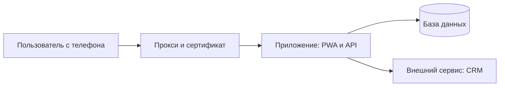

# Режим S. Свой продукт: PRD и схема архитектуры

Скажи в начале (своими словами): сейчас превратим вашу задачу в настоящий PRD —
документ, по которому продукт собирают в IT-командах, — и в схему архитектуры.
Начнём не с экранов, а с того, что болит: продукт должен убрать конкретную проблему
в вашей работе, и на Demo Day вы покажете, что изменилось. Займёт 20–30 минут.
Кода пока не будет.

Уже есть `DESIGN.md` или `ARCHITECTURE.md` от `/design` и `/architecture` — прочитай
и не переспрашивай то, что там решено. Уже есть код — посмотри, что он делает.

## Вопросы

1. **Боль.** Что сейчас делается руками, теряется, считается с ошибками или
   слишком поздно? Варианты подбирай под то, что человек написал в аргументе, и под
   его работу. Цель — одна фраза «сейчас я каждый раз делаю X, и это стоит Y».
2. **Цена боли.** Сколько часов в неделю, сколько денег, заявок или ошибок. Нужна
   **цифра**, хотя бы оценка: это «было» для Demo Day. Человек не знает — предложи,
   как замерить за одну неделю.
3. **Кто пользуется.** Только я · моя команда · клиенты · команда и клиенты с разными
   правами. Отсюда появляются роли.
4. **Главное действие.** Что человек делает в продукте чаще всего. Оно должно быть
   на первом экране, в одно-два касания.
5. **Данные.** Что продукт хранит: перечисли «предметы» своими словами (клиент, заявка,
   заказ). Есть ли персональные или платёжные данные — это сразу повышает требования
   к защите, скажи вслух.
6. **Внешние сервисы.** Откуда приходят данные и куда уходят: CRM, 1С, таблицы,
   мессенджеры, оплата, модель ИИ. Для каждого: читаем, пишем или и то и другое,
   и есть ли у человека доступ к API.
7. **Вход.** Не нужен · по логину для своих (рекомендую, если есть роли) · через
   Google или Microsoft · для клиентов с регистрацией.
8. **Сколько пользователей в первые полгода.** До ста · до тысячи · больше.
   Подталкивай к честной оценке: завышенная цифра делает продукт дороже без пользы.
9. **Бюджет и что уже есть.** Сколько готовы платить в месяц и что уже оплачено
   (домен, сервер, аккаунты). Уже оплаченное выигрывает у более удобного, но платного.
10. **Объём первой версии.** Предложи урезать до одного-трёх экранов, которые убирают
    боль из вопроса 1. Остальное — в «Не делаем сейчас».

Перед записью перескажи в 4–6 предложениях: боль и её цена, кто пользуется, главное
действие, какие данные, что входит в первую версию. Спроси «Всё верно?».

## SPEC.md — настоящий PRD

Критерии готовности пиши проверяемыми — действием или числом, а не ощущением.
Плохо: «удобный интерфейс». Хорошо: «менеджер создаёт заявку с телефона за три
касания», «чужую заявку нельзя открыть, подставив её номер в адрес», «отчёт, который
собирался 4 часа в неделю, собирается за 0 минут».

Тексты кнопок и сообщений — дословно, а не «сообщение об ошибке».

```markdown
---
service_id: [короткое имя продукта латиницей]
spec_version: 1.0
status: черновик | утверждено
owner: [кто отвечает за продукт]
---

# PRD продукта «[Название]»

## 1. Боль и результат
**Сейчас**: [что происходит, одной-двумя фразами]
**Цена боли**: [часов в неделю / денег / заявок / ошибок] — как замерили: [...]
**После запуска**: [что изменится, тем же измерением]
**Метрика успеха для Demo Day**: [было X → стало Y]

## 2. Пользователи и роли
| Роль | Кто это | Как часто | Что видит | Что может менять |
|---|---|---|---|---|
| `admin` | ... | ... | ... | ... |

## 3. Главное действие
[одна фраза] — доступно с первого экрана за [N] касаний.

## 4. Экраны
### 4.1 [Экран]
Зачем · что на нём сверху вниз · главная кнопка (точный текст) · куда ведёт ·
пусто / загрузка / ошибка / нет сети (точные тексты)

## 5. Данные
### Сущности
| Сущность | Главные поля | Связи | Персональные данные |
|---|---|---|---|
| Заявка | клиент, статус, сумма, дата | много заявок у одного клиента | телефон клиента |

## 6. Показатели продукта
| Показатель | Формула | Откуда данные | Где показываем |
|---|---|---|---|

## 7. Внешние сервисы и API
| Сервис | Что берём | Что отдаём | Как часто | Доступ к API есть? |
|---|---|---|---|---|

## 8. Условия работы
Устройства: [телефон / компьютер / оба] · пользователей в первые полгода: [...] ·
работа без сети: [не нужна / показать последнее / ввод офлайн] · вход: [...]

## 9. Доступы и персональные данные
Какие персональные данные хранит продукт · кому показываются полностью · что
скрывается маской · где физически лежат данные

## 10. Критерии готовности
- [ ] ...

## 11. Не делаем сейчас
- ...

## 12. План спринтов
- [ ] Неделя 1 · План: PRD и схема архитектуры в репозитории (`/airl-spec`)
- [ ] Неделя 2 · Данные: база и API (`/airl-dwh`), экраны как PWA (`/airl-pwa`)
- [ ] Неделя 3 · Защита: вход, роли, ключи, чек-лист (`/airl-cybersecurity`)
- [ ] Неделя 4 · Запуск: сервер, домен, выкладка из GitHub (`/airl-devops`), код-ревью
- [ ] Demo Day: «было → стало» из раздела 1 на своём домене

## 13. Решено по умолчанию
- ...
```

Номера разделов не меняй и не пропускай: следующие навыки находят роли в разделе 2,
экраны в 4, данные в 5, персональные данные в 9, критерии в 10, план в 12.

`airl.service.json` в этом режиме не создаётся.

## ARCHITECTURE.md — схема архитектуры

Выбирай технологии по лестнице, снизу вверх и не перепрыгивая: то, что **уже есть
и оплачено** → **постоянно бесплатное** → **дешёвое** → **платное**, только когда
первые три не закрывают задачу. Каждая технология должна быть нужна хотя бы одному
экрану или критерию из `SPEC.md`. Цену называй с пометкой «уточните на сайте
провайдера». Покажи таблицу и схему в переписке, дождись «да», потом записывай.

````markdown
# Архитектура продукта «[Название]»

## Что строим
[одна фраза из SPEC.md раздел 1]

## Ответы на базовые вопросы
| Вопрос | Ответ |
|---|---|
| Пользователей в первые полгода | ... |
| Какие данные храним | обычные / персональные / платёжные |
| Вход | ... |
| Оплата внутри продукта | нет / позже / сразу |
| Бюджет в месяц | ... ₸ |
| Уже есть и оплачено | ... |

## Технологии
| Что | Чем делаем | Почему | Цена сейчас | Цена при росте |
|---|---|---|---|---|
| Интерфейс (PWA) | ... | ... | ... | ... |
| Серверная часть и API | ... | ... | ... | ... |
| База данных | ... | ... | ... | ... |
| Вход и роли | ... | ... | ... | ... |
| Сервер и домен | ... | ... | ... | ... |

**Итого в месяц**: ___ ₸

## Схема

(рисуй по ответам человека; подписи простым языком)

## Что решили не делать в первой версии
- ...

## Контекст для следующих шагов
```yaml
# airl-context
mode: solo
users_6m: "до 100"
data_kind: ordinary | personal | payment
login: none | staff | clients | both
payment: none | later | now
budget_month_kzt: 0
already_have: [домен, сервер]
level: 1
services: ["app: интерфейс и API"]
external_apis: [amoCRM]
maintainer: self-novice | self-experienced | team | contractor
unknowns: []
```
````

Если в продукте больше одного сервиса, есть очередь, файлы, фоновые задачи или
несколько баз — после этого шага предложи `/airl-architecture-extra`: он уточнит
связи и надёжность и дополнит этот же файл. Для одного приложения с одной базой
он не нужен.

В конце режима S скажи: что создано, что решено по умолчанию, сумма в месяц,
и следующий шаг — закоммитить `SPEC.md` и `ARCHITECTURE.md` в репозиторий (это
задача спринта недели 1), затем `/airl-dwh`.
